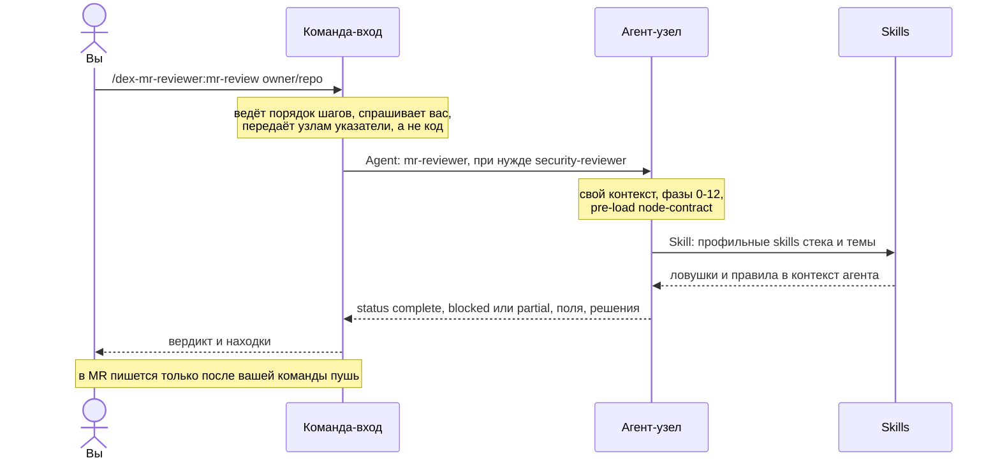
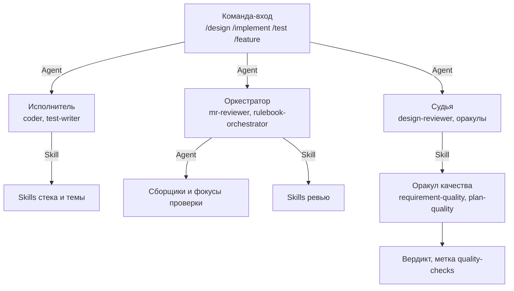
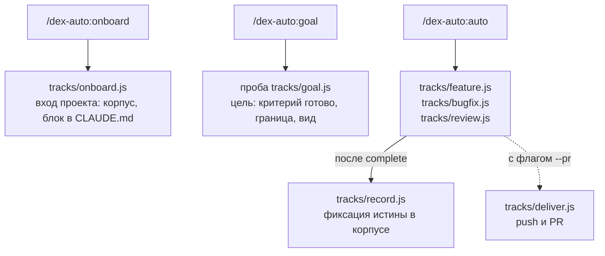
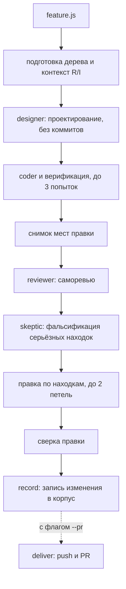

Как читать эту страницу: в схеме ниже сверху вниз идёт вызов, снизу вверх - возврат. Вопросы к человеку поднимаются по тому же пути вверх, пока не доходят до команды, потому что канал к оператору есть только у неё.

## Один запуск команды

Пример из каталога: `/dex-mr-reviewer:mr-review owner/repo#42`.

Что здесь важно:

- **Команда работает в вашей сессии, агент - в своём контексте.** Агент не видит ваш разговор, поэтому всё нужное ему команда передаёт явно; результат возвращается в сжатом виде, и контекст сессии не засоряется чтением кода.
- **Вопрос задаёт команда, не агент.** Вызванный командой агент невыводимое не спрашивает у вас, а возвращает `blocked` или `partial` с названием недостающего. Это режим `interactive` в handoff. В режиме `autonomous` человека нет, и агент закрывает развилку по правилам реакции на нехватку: выводимое выводит, невыводимое возвращает.
- **Первое поле выхода - `status`.** Три значения: `complete`, `blocked`, `partial`. Вызывающая сторона разбирает исход, не читая текст. Решения, принятые узлом самостоятельно, возвращаются списком с основанием; молча решать за вас узел не вправе.
- **Запись во внешний мир - только по явной санкции.** `mr-review` ничего не пишет в MR до команды `пушь`; `/dex-stand-reviewer:review-stand` на стенде только читает. Дефолт режима санкцией не считается ([контракт стыка](https://github.com/dex-it/ai-kit/blob/main/plugins/skills/dex-skill-node-contract/skills/node-contract/SKILL.md), раздел «Outward-facing действие = явная санкция, не дефолт режима»).

Контракт стыка (поля выхода, метка `quality-checks`, режимы) - в skill `dex-skill-node-contract:node-contract`. Он едет в каждый агент как pre-load, поэтому нормативный дом правила - установленный плагин, а не `docs/` репозитория.

## Кто кого вызывает

Три роли узлов:

- **Исполнитель** делает одну работу и возвращает результат: кодер, тестописатель, автор ADR.
- **Оркестратор** сам разбирает задачу на независимые части и раздаёт их. `mr-reviewer` на фазе «Parallel Deep Scan» проходит diff независимыми фокусами по осям, активным для этого diff (безопасность, архитектура, корректность языка, бизнес-логика, регрессии, производительность), затем фальсифицирует каждую находку, дедуплицирует и калибрует severity. Порог делегирования записан в [Parallel Reviewer Orchestration](https://github.com/dex-it/ai-kit/blob/main/docs/AGENT_FRAMEWORK.md#parallel-reviewer-orchestration-fan-out): работу, которая закрывается несколькими вызовами инструментов, делают сами, а веер субагентов оправдан для действительно независимых широких треков.
- **Судья** оценивает чужой артефакт по оракулу качества и ставит метку `quality-checks`. Метку ставит узел, не писавший артефакт: автор сам себе вердикт не выдаёт.

### Возвратные петли

Петли ограничены потолком, иначе агенты ходят по кругу:

- `/dex-architect:design` не сдаёт результат без вердиктов `passed` приёмки дизайна и плана; при ином вердикте возвращает на доработку.
- В треках `dex-auto` кодер и верификация идут до трёх попыток, правка по находкам ревью - до двух (потолки зашиты в скрипты треков).
- Находка ревью снимается только опровержением; низкая уверенность отправляет её в блок «перепроверить», а не в отчёт как факт.

## Автономные треки dex-auto

`dex-auto` отличается тем, что порядок работы задаёт не текст агента, а скрипт.

Как идёт трек `feature` ([компоненты плагина](https://github.com/dex-it/ai-kit/blob/main/plugins/auto/docs/components.md)):

Отличия от обычной команды:

- **Модель и схему выхода каждого узла задаёт скрипт трека**, поэтому у узлов `dex-auto` нет `model` во frontmatter ([Модель и effort](/practices/models-effort/)).
- **Состояние лежит вне репозитория**: журнал задачи (ledger) в каталоге конфигурации Claude Code, `~/.claude/projects/<проект>/ledger/<TASK>/`. Поэтому прогон можно продолжить командой `продолжить`, а оборвавшуюся сессию подхватывает хук `SessionStart`.
- **Остановку удерживает хук `Stop`**: пока у открытой цели нет исхода, ход не заканчивается.
- **Готово подтверждает прогон кода**: верификацию (сборку и тесты) ведёт скрипт `verify.py`, а не модель; сдачу исхода пишет `finish.sh`.
- **Нет установленного агента каталога - замена `general-purpose`** с ролью в промпте, и замена записывается в возврат полем `degraded`. Узел самого плагина замены не имеет: не отработал диагност или кодер - трек `blocked`.

Пользовательский путь по этим трекам: [Отдать задачу целиком](/scenarios/auto/), обзор плагина: [Автономная работа](/concepts/auto/).

## Чем команда отличается от трека

| | Команда-вход | Трек dex-auto |
|---|---|---|
| Кто ведёт порядок | текст команды, исполняет главный поток | скрипт Workflow |
| Спросить человека | да, в заданных местах | по умолчанию нет: вопрос становится `blocked` с причиной; с `--interactive` агенты спрашивают |
| Состояние | в сессии | ledger вне рабочего дерева, можно возобновить |
| Что подтверждает готовность | отчёт команды и вердикты оракулов | прогон сборки и тестов скриптом, независимая проверка находок |

## Читать дальше

- [Контекст: что и когда загружается](/architecture/context-loading/): что из этой схемы стоит байт.
- [Загрузка по стеку](/architecture/stack-loading/): как узел выбирает skills.
- [Команды](/concepts/commands/) и [Специалисты](/concepts/specialists/): те же сущности с точки зрения пользователя.
