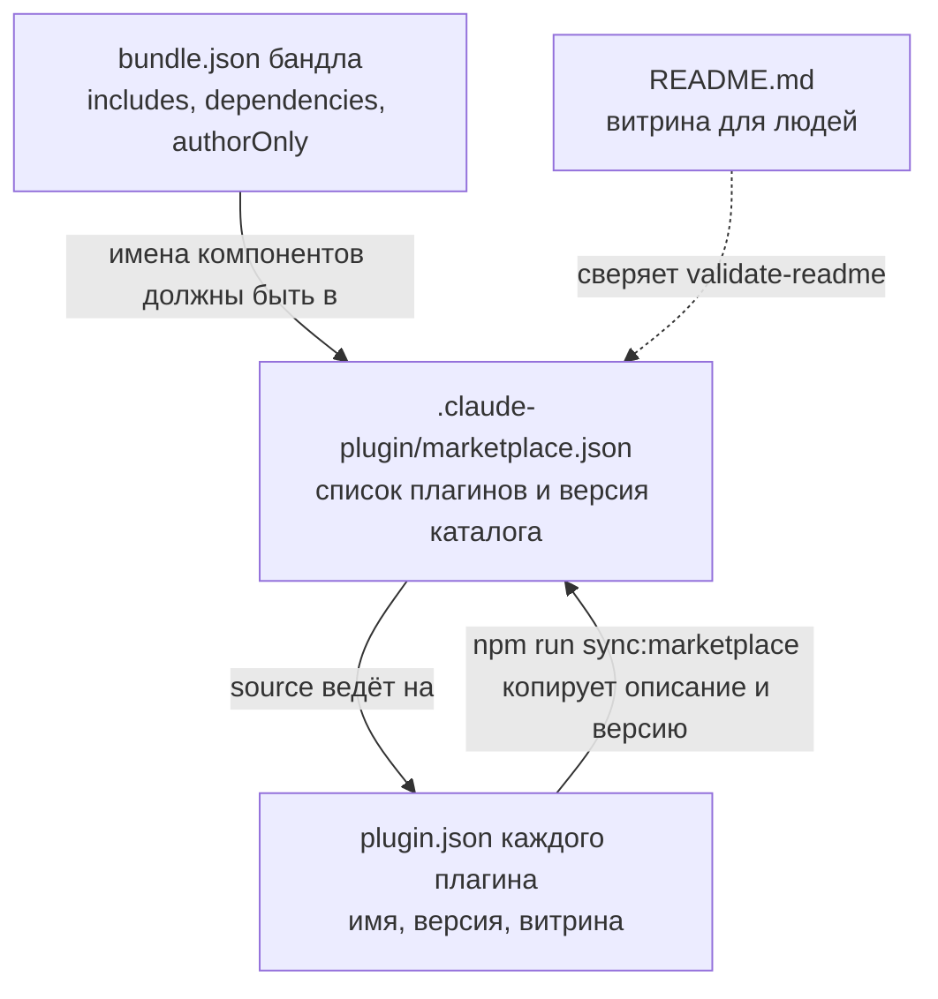

Страница отвечает на вопрос «откуда каталог знает, что в нём есть, и как это не разъезжается». Правила для автора, которые стоят за этой механикой, - в [Версии](/contributing/versions/) и [Бандлы и плагины](/authoring/plugin-bundle/).

## Три манифеста и одна витрина

| Файл | Что хранит | Кто пишет |
|---|---|---|
| `.claude-plugin/marketplace.json` | главный источник истины по составу (README - второй носитель, его сверяет валидатор): список плагинов (`name`, `source`, `description`, `version`, `category`, `keywords`) и версия самого каталога | руками добавляется запись; `description` и `version` генерирует `npm run sync:marketplace` |
| `<плагин>/.claude-plugin/plugin.json` | манифест плагина: имя, версия, витрина (`description`), автор, ключевые слова, лицензия; у мода `userConfig`, у `dex-auto` `workflows` | автор плагина |
| `<бандл>/bundle.json` | `includes[]` - профиль роли, `dependencies[]` - подтянутое замыканием, `authorOnly[]` - плагины только для локального клона автора | автор бандла |
| `README.md` в корне | витрина для людей: таблицы плагинов по видам, перечень skills по темам | руками, генератора нет |

Дом описания - `plugin.json`. Копия в `marketplace.json` генерируется: при разных текстах установленный плагин показывает описание манифеста, а каталожное не видно нигде после установки (зонд описан в [plugin-changes.md](https://github.com/dex-it/ai-kit/blob/main/.claude/rules/plugin-changes.md)). Поэтому правка делается в `plugin.json`, затем запускается `npm run sync:marketplace`; `--check` показывает расхождения без записи.

Описание живёт в двух жанрах. **Поле срабатывания** - `description` во frontmatter skill и агента: по нему модель выбирает единицу. **Витрина** - `description` в `plugin.json`: для человека в списке `/plugin`. Копировать одно в другое нельзя, потому что тексты решают разные задачи ([Как писать description](/authoring/descriptions/)).

## Что значит каждая версия

Версий несколько, и они независимы:

| Версия | Где | Когда растёт |
|---|---|---|
| Версия плагина | `plugin.json` и запись в `marketplace.json`, обе синхронно | по правилам semver ниже |
| Версия бандла | `plugin.json` бандла | меняется состав `includes[]` или `dependencies[]` |
| Версия каталога | `version` в `marketplace.json` и подвал `README.md` | добавление или удаление плагина: minor |

Правила semver для плагина (полный список - в [plugin-changes.md](https://github.com/dex-it/ai-kit/blob/main/.claude/rules/plugin-changes.md)):

| Изменение | Версия |
|---|---|
| Новый плагин | `1.0.0` |
| Новые ловушки или категория в skill, dedup | minor |
| Правка описания, ключевых слов, опечатка | patch |
| Переименование плагина или агента, изменение формата выхода агента | major |

Расхождение версий `plugin.json` и `marketplace.json` ловит правило `version-mismatch` (предупреждение), расхождение подвала README с версией каталога - `readme-version-drift` (ошибка). Эти проверки существуют потому, что версия «забывается» чаще всего.

## Как определяется вид плагина

Поле `category` не выбирают, оно выводится из содержимого: есть `bundle.json` - `bundle`; `agents/` - `specialist`; `skills/` - `skill`; `hooks/hooks.json` с ключом `modules` - `mod`; `hooks/` или `commands/` - `utility`. Порядок проверки именно такой, потому что специалист тоже может нести `commands/`, а папка `hooks/` есть и у мода, и у утилиты. Несоответствие ловит `catalog-category-mismatch`.

## Переименование и снятие

Установщики ничего не удаляют. Бандл-скрипт и `sync-plugins.sh` только доставляют недостающее; снятый или переименованный плагин остаётся у пользователя и продолжает грузиться под старым именем. Поэтому:

1. Каталог ведёт таблицу «Renamed and removed plugins» в `install-bundle/README.md`: старое имя, замена, причина. Правило `removed-plugin-live` следит, чтобы имя из таблицы не оставалось живым в каталоге.
2. `./install-bundle/sync-plugins.sh` называет установленные плагины каталога, которых в нём больше нет, и печатает команду снятия, но сам не удаляет.
3. Пользователь снимает вручную: `claude plugins uninstall <старое-имя>`.

Переименование агента - major-версия плагина. Каталог плагина и поле `name` в `plugin.json` при этом не меняются: `bundle.json` ссылается на каталог, а не на агента.

Для пользователя этот же процесс описан на странице [Обновление и удаление](/start/update-remove/).

## Что ещё скрепляет каталог

- **Замкнутость бандла.** Если команда, агент или skill бандла называет `dex-X:Y`, плагин `dex-X` должен ехать в том же бандле. Нарушение ловят три правила `bundle-*-not-closed`.
- **Имена из словаря.** Новые имена сущностей заводятся строкой в [словаре](/architecture/corpus-glossary/) тем же изменением.
- **Каталог документации каталога не входит в плагин.** В тексте артефакта нельзя ссылаться на `docs/` репозитория: в установленный плагин он не попадает (`catalog-docs-link`).

Как все эти проверки собираются в гейт перед PR: [Цепочка проверок](/architecture/validation-chain/).
