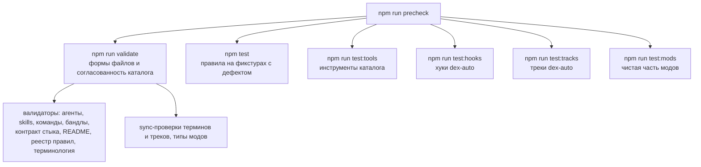

Проверки каталога строятся вокруг одной мысли: правило, которое нельзя проверить, не работает. Страница показывает, из чего состоит гейт, как проверки связаны друг с другом и где граница автоматики. Практический порядок действий автора - в [Проверки перед коммитом](/contributing/checks/) и [Тестировать изменения](/authoring/testing/).

## Из чего состоит гейт

`precheck` - это `validate` плюс все тест-шаги CI. Его запускают перед пушем в ветку PR: `validate` и `npm test` по отдельности не ловят красный `test:tools`.

Отдельно от гейта стоит `npm run check:drift`: он ищет устаревшие ссылки в нормах, расхождение чисел с `marketplace.json` и просроченные сверки с документацией. Находки категорий a-c дают ненулевой код выхода, просроченные сверки (категория d) - сигнал, ошибкой становятся только с флагом `--strict`.

## Две стороны одной проверки

| Что | Где правило должно сработать | Что ловит |
|---|---|---|
| `npm run validate` | на живом каталоге оно должно молчать | реальные нарушения в плагинах |
| `npm test` | на фикстуре с заведомым дефектом оно должно сработать | выключившееся правило: сломалась регулярка, ушла ветка под условие |

Без второй стороны молчание валидатора на живом каталоге неотличимо от соблюдённого правила. Каждая пара «валидатор x правило» несёт фикстуру в `tools/__fixtures__`, а эталонное дерево `_base` обязано давать ноль находок всем валидаторам.

## Мета-проверка

`validate-rules-documented.js` связывает правила с документацией: каждое правило из `tools/validate-*.js` обязано иметь строку в [VALIDATOR_RULES.md](https://github.com/dex-it/ai-kit/blob/main/docs/VALIDATOR_RULES.md) и фикстуру, и наоборот. Поэтому сообщение валидатора всегда ведёт к норме: имя правила в выводе можно найти в реестре и прочитать, почему оно существует ([типичные ошибки валидаторов](/authoring/validators/)).

## Что кто проверяет

| Валидатор | Что проверяет |
|---|---|
| `validate-agent.js` | frontmatter агента (`name`, `description`, `tools`, `model`, `effort`, `skills`), фазы с целью и наблюдаемым критерием завершения, handoff, ссылки на skills и документы |
| `validate-skill.js` | frontmatter, описание и ключевые слова активации, форма ловушек, размер и длина блоков кода, ссылки |
| `validate-command.js` | frontmatter команды, форма «цель и выход» вместо скрипта, размер, ссылки |
| `validate-bundle.js` | состав бандла, замкнутость, согласованность `plugin.json` и `marketplace.json`, категория |
| `validate-node-contract.js` | написание имён полей контракта стыка |
| `validate-readme.js` | что каждый плагин назван в витрине README, версия каталога, таблица снятых |
| `validate-terminology.js` | имена из словаря, вытесняемые имена, дом строки словаря |
| `typecheck:mods` | типы TypeScript модов против контракта клиента |

Дополнительно `sync-terminology --check` и `sync-tracks --check` проверяют, что сгенерированные файлы (перечень терминов, фрагменты треков) совпадают с источниками.

## CI

Workflow «Validate Plugins» повторяет локальный гейт отдельными шагами (по шагу на валидатор, чтобы при падении было видно, какой сработал), затем тесты инструментов, хуков, треков и модов, затем проверка витрины. Второй job проверяет синтаксис всех shell-скриптов. На pull request этот workflow запускается без фильтра путей: его проверки обязательные, а обязательная проверка, которая не запустилась, вешает PR в состоянии BLOCKED.

Workflow «Docs site» собирает этот сайт и проверяет ссылки, но на pull request запускается только при изменениях страниц, конфига сайта, баннеров и метаданных плагинов (фильтр путей). На push в `develop` и `main` он идёт всегда и публикует сайт; есть и ручной запуск.

Проверка `check:drift` в CI не входит: это локальная проверка автора.

## Где граница автоматики

Валидатор судит форму файла. Вручную проверяется то, чего он не видит: обобщённость ловушки, отсутствие пересказа документации API в skill, смысл объявленной сигнатуры handoff, содержание `references/`. Для правок, чей предмет - поведение исполнителя, а не форма файла, есть наборы кейсов с прогоном на модели (`tests/`); они платные и в CI не входят. Подробности - в [Тестировать изменения](/authoring/testing/).
