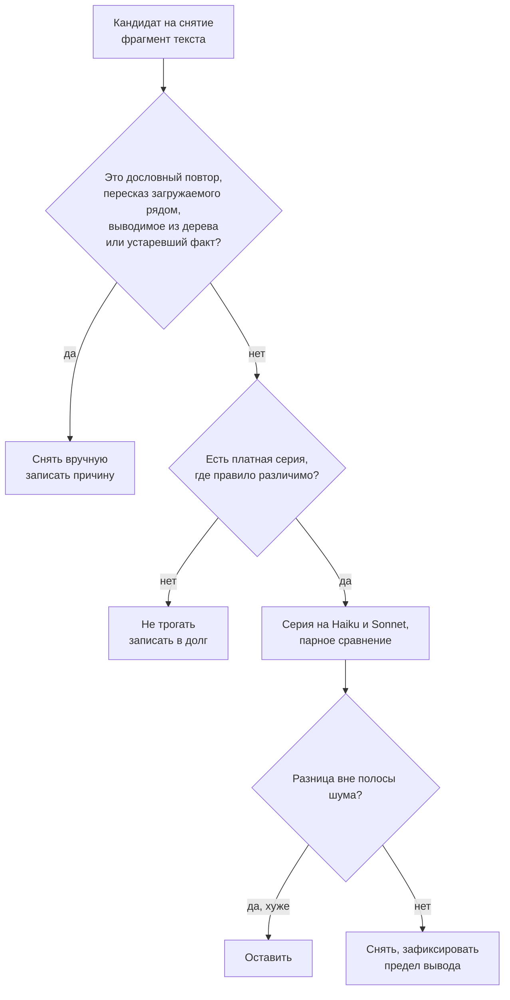
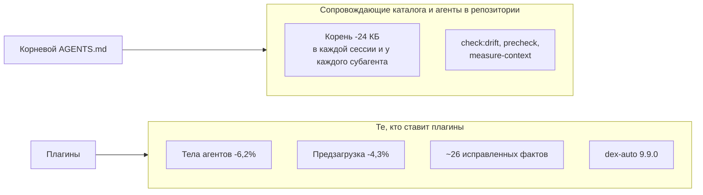

# Лаконичнее и точнее: как каталог перестроили под Claude 5.5 и что из этого доказано

Исследование эпика [#7](https://github.com/dex-it/ai-kit/issues/7). Период 26.10-03.11.2026. Сверено 03.11.2026: `develop` @ `6b1c09ea`, `main` @ `af024401` (релиз 6.27.0).

Документ собирает в одном месте то, что в эпике лежит по частям: внешние работы и документацию Anthropic, наши измерения (в том числе платные прогоны моделей), анализ того, где они сходятся и где расходятся, и честную границу выводов. Все числа взяты из отчётов итераций 0-8 в эпике, из `tests/eval55/` и из замера `node tools/measure-context.js` на двух коммитах; где число пересчитано заново, это сказано.

## Содержание

1. [Простыми словами](#1-простыми-словами)
2. [Итог в цифрах](#2-итог-в-цифрах)
3. [Как мы решали, что можно убирать](#3-как-мы-решали-что-можно-убирать)
4. [Что говорит внешняя наука](#4-что-говорит-внешняя-наука)
5. [Что говорит документация Anthropic](#5-что-говорит-документация-anthropic)
6. [Наши измерения, серия за серией](#6-наши-измерения-серия-за-серией)
7. [Анализ: где литература и наши данные сходятся, а где нет](#7-анализ-где-литература-и-наши-данные-сходятся-а-где-нет)
8. [Кому это даёт выигрыш](#8-кому-это-даёт-выигрыш)
9. [Что не доказано и что дальше](#9-что-не-доказано-и-что-дальше)
10. [Как воспроизвести](#10-как-воспроизвести)
11. [Реестр источников](#11-реестр-источников)

---

## 1. Простыми словами

**Проблема.** Каталог - это тексты для модели: правила репозитория, описания навыков (skills), тела агентов и команд. Модель читает их каждый раз и платит за это деньгами и вниманием. Со временем тексты разрослись: правила повторяли друг друга, агенты пересказывали то, что и так загружается рядом, часть утверждений о платформах устарела. Новая линейка Claude 5.5 умеет больше и меньше нуждается в подсказках, которые писались для прошлых моделей.

**Что мы сделали.** Не «сжали всё на 30%», а ответили на вопрос «что из этого текста доказуемо нужно». Для этого построили стенд измерений, а правила принятия решений записали до прогонов. Дальше убирали только то, что:

- повторяется дословно или пересказывает соседний текст, который и так загружается;
- выводится из самого дерева репозитория (список папок, команды из `package.json`);
- уже охраняется проверкой в коде, а не словами;
- устарело или неверно (проверено по первоисточнику).

**Что получилось.**

- Корневой файл норм стал вдвое короче (47 526 -> 23 516 байт, -50,5%). На Sonnet качество работы с каталогом осталось тем же (1,00 против 1,00 на 240 прогонах), а стоимость одного прогона упала на 16%.
- Постоянная часть контекста сессии (корень, правила, список описаний) уменьшилась на 14,1%.
- Агенты стали короче на 6,2%, а скилл `node-contract`, который 64 агента загружают при старте, перестал пересказываться в их телах: -137 408 байт на один прогон всех этих агентов.
- Выбор нужного скилла по описанию не ухудшился: на двух моделях, 720 прогонах, в том числе при росте библиотеки с 10 до 100 скиллов.
- Нашли и исправили около 26 фактических ошибок в текстах (несуществующие флаги инструментов, неверные имена, устаревшие названия продуктов). Их не видит ни один валидатор.

**Чего мы НЕ доказали.** Что «все скиллы стали эффективнее без потери качества». Сами тела скиллов уменьшились лишь на 2,5%, а сравнения «до/после» на реальных задачах скиллов нет. Поведение агентов на задачах после сокращения тоже не измерялось (так решил владелец, чтобы не тратить деньги). Подробно в [разделе 9](#9-что-не-доказано-и-что-дальше).

**Почему «дёшево и быстро» здесь не получилось.** Мы проверили самый очевидный путь - попросить модель сжать текст. Он оказался опасным: чем сильнее сжатие и чем слабее модель, тем больше теряется ограничений (Haiku при сжатии до 70% теряет 0,17 доли проверок). Поэтому всё сокращение сделано вручную, а каждое снятие записано с причиной.

---

## 2. Итог в цифрах

Замер одним инструментом, `node tools/measure-context.js --json`, на `main` @ `af024401` и на `develop` @ `6b1c09ea`; разность - `--diff`. Меру задают байты, строки и знаки; токены не оцениваются.

| Что | `main` | `develop` | Разница |
| --- | ---: | ---: | ---: |
| Корневой файл норм (`CLAUDE.md` на `main`; `AGENTS.md` + указатель `CLAUDE.md` на `develop`) | 47 526 B, 147 строк | 23 516 B, 65 строк | **-24 010 B (-50,5%)** |
| Постоянный слой (корень, правила, листинг описаний) | 170 256 B, 163 строки | 146 228 B, 81 строка | **-24 028 B (-14,1%)** |
| Правило `plugin-changes.md` | 25 382 B | 21 586 B | -3 796 B (-15,0%) |
| Предзагрузка skills при запуске всех агентов | 3 333 234 B | 3 190 726 B | **-142 508 B (-4,3%)** |
| из них `node-contract` (64 агента) | 3 155 840 B | 3 018 432 B | -137 408 B (-4,4%) |
| Тела 75 агентов | 1 140 361 B | 1 069 875 B | **-70 486 B (-6,2%)** |
| Тела 102 skills (`SKILL.md`) | 637 607 B | 621 620 B | -15 987 B (-2,5%) |
| Тела 110 команд | 345 283 B | 340 953 B | -4 330 B (-1,3%) |
| Описания в листинге (skills, агенты, команды) | 118 586 B | 118 541 B | -45 B |
| Запреты и принуждение в текстах (счётчик `--prohibitions`) | 266 | 248 | -18 |

Как читать. Постоянный слой уменьшился почти ровно на размер корня (-24 028 против -24 010): весь выигрыш слоя - это корень. Описания, по которым модель выбирает skill, агента или команду, практически не менялись (-45 B), поэтому на выбор это не влияет. Агенты и предзагрузка - отдельный выигрыш, он считается не в постоянном слое.

Платные прогоны моделей (Haiku 5.5 и Sonnet 5.5, Opus не гонялся), расход по отчётам итераций:

| Блок | Что мерили | USD |
| --- | --- | ---: |
| Итерация 0 | пилоты, контроль чувствительности, шум E10 | 14,35 |
| Итерация 1 | E1 (Haiku), E1b, калибровка шума E1, проба лаунчера | около 41,5 |
| Итерация 2 | пробы по группам skills S1-S10 | около 39,0 |
| Итерация 3 (добавление) | E1 на Sonnet, проверочная серия `minimal-plus` | 36,65 |
| Итерация 8 | E5, E7 (после и до), E2 | 19,15 |
| **Итого** | | **около 151** |

---

## 3. Как мы решали, что можно убирать

Правила принятия решений записаны до прогонов в [`tests/eval55/PREREG.md`](../../../tests/eval55/PREREG.md), а не подобраны под результат. Суть:



- **Правило нулевого прироста.** Правка не должна увеличивать постоянный слой; любое добавление называет, что снимается взамен. Линейка - `measure-context`: разность двух замеров совпадает с `git diff --numstat`.
- **Только ручное снятие.** Автоматическое сжатие моделью не используется: наш замер E5 (раздел 6.3) и работы R44, R48 показывают потерю условий и границ.
- **Парное сравнение и полоса шума.** Одна и та же задача решается «с текстом» и «без текста» (или «до» и «после»). Порог значимости - `max(|A-B| двух независимых прогонов базы, 2 SE пары)`. Одиночный прогон не отделяет эффект от дисперсии модели.
- **Контроль чувствительности.** Эксперимент допускается к решениям, только если он различает известную поломку. Это отсекло половину первоначальных наборов: на «потолке» (1,00 на всех условиях) любое снятие выглядит безвредным, хотя ничего не доказано.
- **Уровни свидетельства** внешних работ: **A** - воспроизводимый замер на нескольких моделях или задачах; **B** - узкий набор; **C** - практика, наблюдение; **D** - мнение. Решения на уровне C и D без нашего прогона не принимаются.
- **Утверждение о платформе - только со сверкой** по документации или живой пробой клиента, с датой. Практика эпика подтвердила правило: из четырёх проверенных расхождений каталога с платформой три оказались неверны или устарели ([итерация 1, раздел 11](https://github.com/dex-it/ai-kit/issues/7#issuecomment-6467048970)).

---

## 4. Что говорит внешняя наука

Реестр эпика включает 104 работы академического потока и 52 страницы документации и практики; в эпик вынесены те, на которые есть ссылки в тексте. Все работы ниже открыты по странице источника 28.10.2026, ключевые числа сверены с аннотацией. Подавляющее большинство работ шло на других моделях: прямых замеров на Claude 5.5 почти нет (исключение - R14, и оно разведочное).

### 4.1 Файлы инструкций репозитория

| Работа | Уровень | Что показала | Что мы из этого взяли |
| --- | :-: | --- | --- |
| [R01, Gloaguen и др.](https://arxiv.org/abs/2602.11988) «Evaluating AGENTS.md» | A | Файлы контекста (сгенерированные моделью и написанные разработчиками) в целом **не повышают долю решённых задач** и поднимают стоимость в среднем более чем на 20%. Агенты инструкциям следуют, а обзоры репозитория бесполезны | Корень держит только то, чего нет в коде. Обзоры структуры снимаем |
| [R02, Lulla и др.](https://arxiv.org/abs/2601.20404) | B | На 10 репозиториях и 124 PR наличие `AGENTS.md` связано с медианным временем меньше на 28,64% и выходными токенами меньше на 16,58% при сопоставимом завершении | Не противоречит R01 (другие метрики, один агент): файл помогает быстрее, но не решает больше |
| [R03, Khatri](https://arxiv.org/abs/2607.27250) | B | На 17 задачах из 3 репозиториев способ подачи контекста заметно не сдвигает корректность; провалы - от недостатка мастерства, а не знаний о репозитории | Подтверждает: обзоры не нужны |
| [R04, Zhang и др.](https://arxiv.org/abs/2604.11088) «Guardrails Beat Guidance» | A (Claude Code, Opus 4.6) | Случайные правила дают тот же прирост (+13,8 п.п.), что экспертные; соблюдение стабильно до 50 правил; полезны **запреты**, вредны положительные директивы | Противоречит рекомендации G1 («положительные примеры лучше запретов»). Не разрешено, проверяется в плановой серии E12 |
| [R05, Xu и Wu](https://arxiv.org/abs/2610.30571) | B | Устаревший файл инструкций перевешивает код: 90,1% выборов в 320 прогонах на 40 проектах следовали файлу; фраза «код главнее описания» вернула 91,4% выборов в пользу кода | Дрейф текста опаснее лишнего текста. Отсюда `check:drift` |
| [R13, Yan](https://arxiv.org/abs/2608.23550) | B | Среди 481 публичного `CLAUDE.md` лишь 4-16% правил безопасности имеют встроенный контроль (строгая оценка 4,4%) | То, что обязано выполняться всегда, живёт в hook или валидаторе, не в тексте |
| [R14, Aliabadi](https://arxiv.org/abs/2610.32578) «Lessons Outlive Their Failures» | C | **На Sonnet 5.5 три из четырёх воспроизведённых прошлых сбоев не повторились ни с правилом, ни без него.** Нужна периодическая перепроверка и снятие правил; устаревшие числа ловит только механическая проверка | Единственная работа прямо про 5.5. Основание для протокола «правило без свидетельства копит долг» |
| [R19, Wang и др.](https://arxiv.org/abs/2610.04832) | A | Правка навыка с **проверяемым правилом (команда, путь)** поднимает соблюдение (+0,41), долю нужного действия (+0,23) и корректность (+0,10) на 16 открытых моделях. Загрузка тела по требованию сохраняет лишь около 51% выигрыша и добавляет 50% токенов эпизода | Блок, определяющий действие, остаётся в предзагрузке. Перенос в `references/` - только с серией |

### 4.2 Длина, плотность, позиция

| Работа | Уровень | Что показала |
| --- | :-: | --- |
| [R28, IFScale](https://arxiv.org/abs/2507.11538) | A | 20 моделей, 500 инструкций: лучшая модель держит 68% на максимальной плотности; три профиля деградации; смещение к ранним инструкциям |
| [R36, Du и др.](https://arxiv.org/abs/2510.05381) | A | На 5 моделях длина входа сама снижает качество на 13,9-85% **даже при идеальном извлечении** нужной информации |
| [R79, SWE-PRBench](https://arxiv.org/abs/2603.26130) | B | 350 PR, 8 моделей: качество монотонно падает с ростом контекста; 2000-токенный промт с диффом и резюме обгоняет 2500-токенный с полным контекстом |
| [R33, Liu и др.](https://arxiv.org/abs/2307.03172) «Lost in the Middle» | A | Середина длинного контекста используется хуже начала и конца. На моделях 5.5 прямых замеров нет |
| [R44, Baxi](https://arxiv.org/abs/2512.17920) | B | На 9 моделях соблюдение ограничений при сжатии описания даёт U-образную кривую: **нарушения максимальны при среднем сжатии**; соблюдение ограничений и смысловая точность статистически ортогональны |
| [R48, Wang и др.](https://arxiv.org/abs/2608.29028) | B | При передаче с бюджетом 25 слов факты сохраняются почти полностью, а метки границ («как можно использовать») - около 0,57 против 0,80; размытые границы утекают в 73% и 50% случаев, явные - менее чем в 15% |

Вывод для нашего случая: объём и число одновременных обязательств - реальный фактор (поэтому правило нулевого прироста), но «короче» не значит «лучше». Условия, пороги и границы резать нельзя (R48), а среднее механическое сжатие опасно (R44).

### 4.3 Skills: выбор, конфликты, польза

| Работа | Уровень | Что показала |
| --- | :-: | --- |
| [R17, SkillsBench](https://arxiv.org/abs/2602.12670) | A | Курируемые skills поднимают средний проход с 33,9% до 50,5% (+16,6 п.п.); сфокусированные skills до трёх модулей лучше исчерпывающих; малые модели со skills сравниваются с большими без них |
| [R18, Yang и Ding](https://arxiv.org/abs/2608.23067) | B (веб-разработка) | Впрыск skill в среднем **снижает** Pass@2 на 1,3-4,2% и поднимает стоимость на 72-394%; польза лишь в 17-36% пар «skill-проект». Skill - гипотеза о тройке «skill, проект, модель» |
| [R20, Razmara и др.](https://arxiv.org/abs/2610.25064) | B | Рядом со skill той же работы правила соблюдаются в 61-62% против 93-99% в одиночку; единый файл довёл соблюдение до 96-99% |
| [R21, Yan и др.](https://arxiv.org/abs/2610.11647) | A/B | Почти каждый четвёртый установленный skill соседствует с skill той же работы; похожий skill перехватывает около одного запуска из пяти; финальный ответ называет подмену в 0,9% случаев |
| [R22, Song и Wei](https://arxiv.org/abs/2605.24050) | B | При росте библиотеки до 202 skills качество падает до 21%; причина - ошибочный выбор, влияние объёма контекста «неотличимо от нуля» |

### 4.4 Границы объёма, самопроверка, субагенты

| Работа | Уровень | Что показала |
| --- | :-: | --- |
| [R98, Qu и др.](https://arxiv.org/abs/2605.18583) | A/B | Снятие явного заявления о разрешённом объёме поднимает долю лишних действий в Claude Code **с 0,0% до 17,1%** (500 сценариев, около 7 500 прогонов) |
| [R97, FixedBench](https://arxiv.org/abs/2605.07769) | B | На 200 задачах, где правка не нужна, агенты предлагают нежелательные изменения в 35-65% случаев; бездействие надо называть допустимым исходом |
| [R84, OverclaimBench](https://arxiv.org/abs/2609.20812) | A | Агенты не читают все назначенные файлы в 67,9% прогонов; из неполных 80,4% вводят в заблуждение |
| [R69, Huang и др.](https://arxiv.org/abs/2310.01798), [R72, CRITIC](https://arxiv.org/abs/2305.11738) | A | Без внешнего сигнала самокоррекция не исправляет рассуждение; с проверкой инструментом помогает |
| [R87, Kim и др.](https://arxiv.org/abs/2512.08296) | A | Мультиагентность: от +80,8% (декомпозируемые задачи) до -70,0% (последовательное планирование) |
| [R88, Tran и Kiela](https://arxiv.org/abs/2604.02460) | B | При равном бюджете токенов рассуждения одиночный агент не хуже мультиагентной системы |
| [R89, Li и др.](https://arxiv.org/abs/2610.10263) | A/B | 354 задачи, 2 124 прогона Codex, Claude Code, Kimi Code: динамическая параллельность увеличивает расход токенов в 1,41-3,31 раза |

Вывод: строки о границе объёма и о праве на бездействие в узких агентах (фиксеры, ревьюеры) **нельзя** сокращать по проценту. Завершение требует внешнего факта (вывод команды, список прочитанного), а не самоотчёта. Безусловный веер субагентов убираем, условный (большие независимые треки) оставляем. Это согласуется и с нашим измерением оркестрации ([`docs/research/orchestration-tiers`](../orchestration-tiers/README.md)): оркестрация проиграла одной сессии в 1,4-3 раза по цене на предмете, где куски помещаются в один контекст.

### 4.5 Язык инструкций и «контролируемый» стиль

| Работа | Уровень | Что показала |
| --- | :-: | --- |
| [R58, Anschütz и др.](https://aclanthology.org/2025.gem-1.70/) | B | Упрощённые тексты **ухудшают** результаты англоязычных моделей: «упрощение помогает людям, но не LLM» |
| [R51, Marco-Bench-MIF](https://arxiv.org/abs/2507.11882), [R52, Multi-IF](https://arxiv.org/abs/2410.15553) | B, A | Точность выполнения инструкций ниже на языках с меньшими ресурсами; ошибки выше у нелатинских письменностей, включая русский |
| [R55, Lost in Execution](https://arxiv.org/abs/2601.05366) | B | Главный сбой вызова инструментов на не-английском - **значения параметров переводятся** на язык пользователя |
| [R56, OLA](https://arxiv.org/abs/2601.03589) | B | Модели нестабильны в выборе языка ответа при смешении языков |
| [T1, статья на Хабре](https://habr.com/ru/articles/1011836/) про ASD-STE100 | D | Обзор стандарта для перевода и локализации; числа о росте совпадений и ускорении заявлены без методики; статья рекламирует продукт автора |

Работ про ASD-STE100 в связке с LLM найти не удалось. Русского стандарта нет, словарь защищён правами.

### 4.6 Что мы не знаем

- Почти нет замеров на Claude 5.5: R01 шла на Sonnet 4.5, R02 на Codex, R03 на двух агентах.
- Нет прямых замеров XML против Markdown для Claude, русских инструкций для skills, порогов длины, влияния файловой памяти на успех.

---

## 5. Что говорит документация Anthropic

| Источник | Что утверждает | Следствие для каталога |
| --- | --- | --- |
| [G2](https://platform.claude.com/docs/en/build-with-claude/prompt-engineering/prompting-claude-opus-5-5), [G3](https://platform.claude.com/docs/en/build-with-claude/prompt-engineering/prompting-claude-sonnet-5-5), [G4](https://platform.claude.com/docs/en/build-with-claude/prompt-engineering/prompting-claude-haiku-5-5) - руководства по промптингу 5.5; [G9](https://platform.claude.com/docs/en/build-with-claude/effort) - effort | Effort по умолчанию `medium` у трёх моделей; у Haiku 5.5 появилась ось effort; для Sonnet/Haiku на `low`/`medium` рекомендован один абзац «реальная проверка» | Не ставить `effort: medium` явно (это дефолт); ставить только измеренные отклонения. Устаревшее правило валидатора про effort у `haiku` отмечено как зависящее от провайдера |
| [G1, Prompting best practices](https://platform.claude.com/docs/en/build-with-claude/prompt-engineering/claude-prompting-best-practices) | Положительные примеры лучше запретов; принципы ясных инструкций | Принципы письма (один термин на понятие, императив, короткое предложение) берём как нормы |
| [K1, memory](https://code.claude.com/docs/en/memory) | `AGENTS.md` читается через `@`-импорт из `CLAUDE.md`; импорт стоимость контекста **не снижает**; тематические файлы читаются по требованию; `/doctor` режет из файлов выводимое из кода | `CLAUDE.md` = `@AGENTS.md`; цена импорта измерена: +109 токенов (+0,6%) |
| [K3, sub-agents](https://code.claude.com/docs/en/sub-agents) | Каждый кастомный и плагинный субагент получает всю иерархию `CLAUDE.md`/`AGENTS.md` (кроме встроенных `Explore` и `Plan`) и предзагруженные skills **целиком** | Рост корня умножается на число запусков; байт `node-contract` стоит 64 байта на прогон всех его агентов |
| [K7, plugins reference](https://code.claude.com/docs/en/plugins-reference) | `CLAUDE.md` в корне плагина контекстом не грузится | Корневой файл каталога нужен сопровождающим; пользователь плагина получает skills, агентов и команды |
| [K10, best practices](https://code.claude.com/docs/en/best-practices), [E2, effective context engineering](https://www.anthropic.com/engineering/effective-context-engineering-for-ai-agents) | В файле держат то, чего нет в коде | Совпадает с R01 и R19 |
| [P1, Skill authoring best practices](https://platform.claude.com/docs/en/agents-and-tools/agent-skills/best-practices) | Требования к description и телу skill | База рубрики |

Расхождения каталога с документацией, найденные при подготовке: утверждение «неизвестное поле `plugin.json` тихо ломает плагин» (по документации и пробе на 2.1.310 плагин загружается, `claude plugin validate` предупреждает); устаревшее правило валидатора про effort у Haiku; недоступность `claude plugin eval`, которая на 2.1.311 оказалась доступной. Поправлено в итерации 1.

---

## 6. Наши измерения, серия за серией

Стенд - [`tests/eval55/`](../../../tests/eval55/README.md): раннер `run.mjs`, шесть экспериментов, песочница из закоммиченного дерева, изоляция `--setting-sources project --strict-mcp-config`. Отчёты итераций в эпике: [0](https://github.com/dex-it/ai-kit/issues/7#issuecomment-6463488469), [1](https://github.com/dex-it/ai-kit/issues/7#issuecomment-6467048970), [2](https://github.com/dex-it/ai-kit/issues/7#issuecomment-6468200053), [3](https://github.com/dex-it/ai-kit/issues/7#issuecomment-6492967651), [3 (добавление)](https://github.com/dex-it/ai-kit/issues/7#issuecomment-6499605701), [4](https://github.com/dex-it/ai-kit/issues/7#issuecomment-6517568710), [5](https://github.com/dex-it/ai-kit/issues/7#issuecomment-6517575816), [6](https://github.com/dex-it/ai-kit/issues/7#issuecomment-6517582129), [7](https://github.com/dex-it/ai-kit/issues/7#issuecomment-6518535514), [8](https://github.com/dex-it/ai-kit/issues/7#issuecomment-6522775083).

### 6.0 Стенд и шум (итерация 0, 14,35 USD)

**Что построено.** Пред-регистрация решающих правил до серий; парное сравнение; контроль чувствительности; полоса шума из двух независимых прогонов базы.

**Результаты.**

- Пилоты показали, что **половина затравок ничего не различает** (потолок 1,00). После усложнения чувствительность подтверждена для E10, E5 (на Haiku), E3 (слабо), E2 (3 правила из 17); E7 не прошёл контроль и был отложен до постановки с жёсткими соседями.
- Полоса шума E10: Haiku 0,11, Sonnet 0,14. Повторный прогон попал в полосу (|A-B| 0,03 и 0,01).
- Первый снимок размеров в самом эпике содержал ошибку (описания агентов и команд завышены в 1,3-2,2 раза); воспроизведение командой ошибку нашло, эпик исправлен.
- Разрыв стенда: E1 и E2 брали корень из рабочего дерева, а песочница собиралась из коммита, и серия на другом коммите молча давала другой состав. Исправлено (`--commit`), в `meta.json` пишутся полный хэш коммита и хэш входов.

**Анализ.** Главная ценность итерации - не цифры, а то, что решение «снять текст» стало проверяемым. Без контроля чувствительности обе наши будущие «безвредные» серии на потолке ничего бы не доказали.

### 6.1 Корень репозитория: E1 (Haiku и Sonnet)

**Вопрос.** Какие части корневого файла норм нужны модели. 16 кейсов сопровождения каталога (размещение skill, переименование агента, новый термин, ссылка из README, снятие плагина, ложная тревога «менять нечего» и другие) с эталонным решением; 12 условий абляции (`full`, `empty`, `minus-s01..s07` по разделам, `no-overview`, `minimal`, `terminology-pointer`).

**Шум.** Две независимые копии `full` (по 96 ячеек, 9,07 и 9,22 USD): Haiku 0,99 и 1,00, Sonnet 1,00 и 0,99 - полоса **0,01**. Решаемость `full` почти полная: различимы только разделы, без которых кейсы ломаются.

**Haiku, 541 действительная ячейка, 7,31 USD** (доля пройденных проверок, парная разность с `full`):

| Условие | n | Доля (SE) | Δ | Ходов | USD/ячейка |
| --- | ---: | --- | ---: | ---: | ---: |
| `full` | 48 | 1,00 (0,00) | - | 14,3 | 0,015 |
| `minimal` (-55% по байтам) | 48 | 1,00 (0,00) | 0,00 | 15,5 | 0,012 |
| `no-overview` | 42 | 1,00 (0,00) | 0,00 | 13,4 | 0,013 |
| `minus-s01`, `s03`, `s05`, `s06` | 42-48 | 1,00 | 0,00 | 14,2-15,9 | 0,014 |
| `minus-s02`, `minus-s04` | 42-43 | 0,99 | -0,01 | 13,6 | 0,014 |
| `terminology-pointer` | 36 | 0,98 (0,01) | -0,02 | 16,1 | 0,015 |
| `minus-s07` («Чек-лист») | 48 | 0,96 (0,02) | **-0,04** | 14,9 | 0,012 |
| `empty` (корня нет) | 48 | 0,91 (0,03) | **-0,09** | 18,0 | 0,013 |

Вне порога только пустой корень и раздел «Чек-лист». Без корня падают проверки на валидность терминов (0/3), размещение skill внутри владельца (0,33), абсолютные ссылки на документацию (0/3). Без «Чек-листа» - те же ссылки из README, бамп версии при смене описания команды, строка в таблице снятых плагинов.

**Sonnet, 240 ячеек, 36,65 USD** (16 кейсов x 3 повтора, парные разности с `full`):

| Условие | n | Доля (SE) | Δ | USD/ячейка |
| --- | ---: | --- | ---: | ---: |
| `full` (корень 45 КБ) | 48 | 1,00 (0,00) | - | 0,177 |
| `minus-s05` (имена, frontmatter) | 48 | 0,99 (0,01) | -0,01 | 0,167 |
| `minimal` (20 КБ) | 48 | 0,97 (0,01) | -0,03 | 0,142 |
| `minimal-plus` (24 КБ) | 48 | **1,00 (0,00)** | **0,00** | **0,149 (-16%)** |
| `empty` | 48 | 0,93 (0,02) | -0,07 | 0,128 |

**Анализ.**

1. Сокращение корня вдвое не стоит качества на обеих моделях. Это согласуется с R01 и R03: обзоры не помогают решать задачи, корень нужен для нестандартных правил.
2. Haiku не заметил разницы между `full` и `minimal`, а Sonnet заметил (-0,03; разница мала и на границе шума). Именно она заставила проверить, что потеряла минимальная форма: ровно два невыводимых правила. `minimal-plus` их вернул и дал 1,00; без прогона Sonnet этот результат остался бы незамеченным. Правило отбора подтверждено цифрами: **выпадает то, что выводится из дерева или уже охраняет валидатор; остаётся то, у чего нет другого дома.**
3. Пустой корень проигрывает на обеих моделях (-0,09 и -0,07), и ходов у него больше (18,0 против 14,3): корень нужен. Прирост по цене на Sonnet - 16%, но это цена ячейки на кейсах сопровождения каталога, не универсальный множитель.
4. Итоговый состав: шапка, «Конвенции», абзац о размещении skill, практические правила композиции, пять единиц чек-листа без дома в валидаторе и пункт «новое имя заводится строкой словаря». `AGENTS.md` 44 860 -> 23 556 B (-47,5%), в таблице раздела 2 с `CLAUDE.md` и указателем -50,5%.

**Пределы.** `full` на потолке; в наборе нет кейсов нового плагина, нового правила валидатора, нового стека, агента с mandatory-фазой, то есть часть норм корня не покрыта; n = 36-48 на условие. Решения по корню принимались на 16 кейсах сопровождения самого ai-kit: что корень не нужен продуктовому проекту, это перенос вывода, не замер.

### 6.2 Банк памяти: E1b

`.memory-bank/` введён решением владельца без измеренной пользы; замер E1b проверил его после ([итерация 1, раздел 5](https://github.com/dex-it/ai-kit/issues/7#issuecomment-6467048970)). 4 зависимые от банка задачи x 3 повтора x 3 условия = 72 ячейки, 4,17 USD. Условия: `bank` (папка и указатель), `home` (те же факты абзацем в документе, без банка), `none`.

| Тир | `bank` | `home` | `none` |
| --- | --- | --- | --- |
| Haiku: доля (SE); ходов; USD/ячейка | 0,83 (0,11); 5,4; 0,007 | 0,75 (0,12); 8,3; 0,010 | 0,67 (0,12); 9,2; 0,011 |
| Sonnet | 0,92 (0,08); 2,9; 0,084 | 0,88 (0,09); 4,7; 0,109 | 0,57 (0,12); 6,8; 0,128 |

**Анализ.** По качеству `home` не хуже `bank` (-0,08 и -0,04, внутри порога 0,27 и 0,26), но дороже на 43% (Haiku) и 30% (Sonnet) за счёт лишних ходов на поиск абзаца. Выигрыш банка у «ничего нет» подтверждён только на Sonnet (-0,35 без банка при пороге 0,22); на Haiku два факта угадываются без банка. Заметка, из которой пошла идея, утверждала «80% результата при 20% затрат»: такого числа нет ни в одном источнике (вердикт «не подтверждено»), а ближайшие независимые данные R01 и R02 меряют другое. Банк остаётся компактным индексом со ссылками-указателями (без `@`), вне постоянного слоя.

**Пределы.** n = 12 пар на ячейку; песочница без истории git; шумовая полоса для `bank` не снималась.

### 6.3 Сжатие модели: E5 (180 ячеек, 1,95 USD)

**Вопрос.** Можно ли сжимать нормативный текст языковой моделью. Десять кейсов, текст сжимается на 30, 50, 70%, ответ проверяется на удержание каждого ограничения.

| Тир | Условие | n | Доля проверок (SE) | Полное соблюдение |
| --- | --- | ---: | --- | ---: |
| Haiku | `llm-30` | 30 | 0,86 (0,03) | 0,47 |
| Haiku | `llm-50` | 30 | 0,79 (0,04) | 0,40 |
| Haiku | `llm-70` | 30 | 0,69 (0,05) | 0,13 |
| Sonnet | `llm-30` | 30 | 0,97 (0,01) | 0,77 |
| Sonnet | `llm-50` | 30 | 0,93 (0,02) | 0,63 |
| Sonnet | `llm-70` | 30 | 0,93 (0,02) | 0,63 |

Парные разности к `llm-30`: Haiku -0,07 и **-0,17** (вне порога), Sonnet -0,03 и -0,03 (на границе порога). Теряются прежде всего запреты и условия запуска (Haiku, кейс `agent-phases`: `no-grep`, `no-code-examples`, `bare-mandatory` падают до 0,00 при 70%).

**Анализ.** Машинное сжатие теряет ограничения, и чем слабее модель, тем сильнее; это воспроизводит работы R44 (пик нарушений при среднем сжатии) и R48 (утечка границ). Отсюда решение эпика: вручную снимать дословные повторы и пересказ, а не прогонять через «ещё короче». Ручное сжатие с механической проверкой удержания (`check-retention`) эту потерю контролирует - на промтах 20-29 удержано 2 164 из 2 169 помеченных ограничений (не удержано 5), в частях 20-24 потеряно 7 из 1 077 пунктов списков.

**Пределы.** n = 30 на условие; E5 меряет выживание проверок на одном шаге сжатия, а не поведение агента на задаче.

### 6.4 Выбор skill: E7 (после и до)

**Вопрос.** Ухудшается ли выбор нужного skill при росте библиотеки и после сокращений текстов (R21, R22). Двадцать кейсов, в листинге 10, 30 или 100 skills; проверки `picked` (верный выбор) и `not-hijacked` (сосед не перехватил). Две серии на одних и тех же кейсах и повторах: до сокращений (`5e16bf87`) и после (`d3031ccb`), по 360 ячеек, 9,65 USD вместе.

| Тир | Условие | До | После | \|Δ\| | Полоса шума |
| --- | --- | ---: | ---: | ---: | ---: |
| Haiku | `lib010` | 0,82 | 0,93 | 0,12 | 0,12 |
| Haiku | `lib030` | 0,92 | 0,92 | 0,00 | 0,10 |
| Haiku | `lib100` | 0,98 | 1,00 | 0,02 | 0,03 |
| Sonnet | `lib010` | 0,95 | 0,95 | 0,00 | - |
| Sonnet | `lib030` | 0,95 | 0,95 | 0,00 | - |
| Sonnet | `lib100` | 1,00 | 1,00 | 0,00 | - |

Масштаб библиотеки (серия «после», 360 ячеек, 5,05 USD): Haiku `lib010` 0,93 -> `lib100` 1,00 (+0,07, вне порога, в пользу большой библиотеки); Sonnet 0,95 -> 1,00 (+0,05, внутри порога).

**Анализ.**

1. Гипотеза «`lib100` проиграет `lib010`» (R22) **не подтверждена**: рост библиотеки до 100 skills выбор не ухудшает. Единственный устойчивый расход условий даёт кейс `implementation-plan-near-review`: соседа-near-miss нет в малой библиотеке, поэтому просьба о ревью плана уходит в `implementation-plan`. Это свойство набора, а не деградация листинга.
2. Пара «до/после»: ни одно различие не выходит за полосу шума, на Sonnet результаты идентичны. Единственная заметная разница (Haiku `lib010`, 0,82 -> 0,93) равна самой полосе. Описания между коммитами различаются на 27 знаков из 63 622, так что по сути это два прогона одного листинга.
3. Согласованность с R22: падение до 21% в работе объясняется **ошибочным выбором при близких соседях**. На нашем каталоге по лексическому сравнению пересекается лишь одна пара описаний (разные стеки), поэтому внутренний риск захвата невысок; внешний (пользователь ставит чужие каталоги) набор не покрывает.

**Пределы.** Потолок 1,00 на `lib100`: набор ловит ухудшение, а не улучшение, поэтому честная формула - «не упало», а не «стало лучше».

### 6.5 Правила корня: E2 (132 ячейки, 7,55 USD)

Одиннадцать кейсов, семь оставшихся в корне правил, условия «с правилом» и «без».

| Тир | `with-rule` | `without-rule` | Δ | Порог |
| --- | ---: | ---: | ---: | ---: |
| Haiku | 0,82 | 0,76 | -0,06 | 0,12 |
| Sonnet | 0,80 | 0,81 | +0,02 | 0,04 |

По правилам (ячеек с правилом против ячеек без него, проверка `rule-held:*`):

| Правило | Haiku | Sonnet | Что показывает |
| --- | --- | --- | --- |
| `no-autoload-claim` | 3/3 против 0/3 | 3/3 против 3/3 | держит поведение на Haiku, Sonnet и сам не делает |
| `no-foreign-address` | 3/6 против 2/6 | 5/6 против 2/6 | держит на Sonnet |
| `no-docs-address` | 3/3 против 2/3 | 3/3 против 3/3 | слабое различие |
| `ascii` | 3/6 против 3/6 | 3/6 против 3/6 | поведение не меняет |
| `no-relative-link`, `no-keywords-field` | 3/3 и 6/6 против того же | то же | потолок, не нагружены |
| `no-allowed-tools` | 4/6 против 6/6 | 5/6 против 6/6 | артефакт кейса, см. ниже |

**Анализ.** В среднем снятие правил не различимо (внутри порога на обеих моделях). Правила `no-autoload-claim` и `no-foreign-address` реально меняют поведение, их снимать нельзя. `ascii`, `no-relative-link`, `no-keywords-field` - кандидаты на снятие, но не по этой серии: два последних на потолке, `ascii` на 3/6 в обоих условиях, и все три охраняются валидаторами. Артефакт `no-allowed-tools`: в кейсе пользователь прямо просит добавить поле, модель с правилом исполняет просьбу и предупреждает, проверка видит добавленное поле и ставит провал; без правила добавляет молча. Это конфликт просьбы и правила, а не вред правила.

Это косвенно подтверждает R14: правила переживают свои сбои не всегда, но те, что действительно держат поведение, различимы на разных моделях по-разному. Корень правок по итогам E2 не получил: n = 3 на ячейку, доказательства «лишнее» нет.

### 6.6 Пробы по группам skills (итерация 2, около 39,0 USD)

Группы S1-S10 вёл отдельный исполнитель по общему брифу. Меряли «пробу удержания» на плечах «старый текст / новый / без skill» (вопросы с регулярными грейдерами), пользу skill на готовых кейсах `tests/trap-skills`, различимость описаний, перенос блока `node-contract` на трёх агентах с вслепую судьёй Sonnet.

| Группа | Файлы до -> после, B | Ключевые числа проб |
| --- | --- | --- |
| S1 контекст проекта | 141 113 -> 137 702 (-3 411) | Haiku 57/65 -> 60/65 (без skill 14/65); Sonnet 38/39 = 38/39 (без skill 12/39) |
| S2 мета-нормы | тела -2 739, `references/` +2 253 | `node-contract` -2 147 B x 64 агента = -137 408 предзагрузки |
| S3 требования | 167 778 -> 163 123 (-4 655) | Haiku 83/90 против 35/90 без skill; Sonnet 54/54 против 16/54 |
| S4 архитектура и API | 39 116 -> 37 299 (-1 817) | Haiku 104/115 (без skill 51); одна правка откачена пробой |
| S5 ревью и тесты | -2 036 (с `references/` -2 697) | Sonnet MC1 12/12 со skill против 0/6 |
| S6 отладка | -97 | 12 исправлений фактов в 5 skills |
| S7 .NET | 0 | 79 из 81 ключевых единиц со skill против 68 без |
| S8 TypeScript, веб | -1 232 | единственное снятие: V3 и V10 в `ts-vitest-jest` (контроль без skill 4/4 на обоих тирах) |
| S9 Python и ML | 0 | `python-project-hygiene` 12/12 против 2/12 |
| S10 инфраструктура | 0 | Sonnet без skill не держит 16 клеток |

**Перенос блока `node-contract` в `references/`** проверялся построчно (Haiku/Sonnet):

| Блок | Haiku, до -> после | Sonnet, до -> после | Решение |
| --- | --- | --- | --- |
| Дедупликация строк правки | 0,94 -> 0,91 | 0,88 -> 0,88 | применено |
| Три строки метки | 1,00 -> 1,00 | 1,00 -> 1,00 | **перенесено** |
| Поля ревью и покрытия тестами | падение -0,36 | падение -0,31 | не перенесено: падение выше полосы |
| `revoke` и `approve` | 1,00 -> 0,70 | - | не перенесено |

**Анализ.**

1. **Skills в большинстве групп приносят пользу.** Пробы «со skill и без» показывают разрыв в разы (2 из 12 без skill против 12 из 12 со skill, 35 против 83 из 90). Это скорее **против** R18 (там впрыск skill в среднем вредит), чем за него: наш каталог - курируемый, с проверкой каждого skill контрольным прогоном, что близко к условиям R17 (курируемые skills поднимают проход). Именно поэтому снято только одно содержательное место.
2. Результат переноса `node-contract` совпадает с R19: безопасны дедупликация и словарные блоки метки; блоки, определяющие действие агента, остаются в предзагрузке. «Перенос в `references/` дешевле» верно не всегда.
3. Три отката по пробе (фраза в `project-docs-map`, правка `project-baseline`, фраза про self-check в `design-quality`: Haiku 3/5 и Sonnet 2/4 против 5/5 и 4/4) - пример того, что проба работает как регрессионный тест формулировок.

**Пределы.** Все пробы, кроме готовых наборов `tests/trap-skills`, - **слабое доказательство**: свои вопросы и судья, n = 1-8 на плечо, полосы шума нет. Это названо в каждом PR. По группе в целом «качество не хуже» подтверждено частично; для S7, S9, S10 тексты не менялись.

### 6.7 Факты: сверка с первоисточниками (итерации 2 и 3, без платных прогонов)

Сверка утверждений в телах skills и агентов с документацией и пробой на установленных пакетах нашла **не меньше 16 ошибок в skills и около десяти в агентах**. Примеры:

| Где | Ошибка | Источник сверки |
| --- | --- | --- |
| `test-coverage` | Jest не принимает `istanbul` (`coverageProvider`: `babel` по умолчанию или `v8`) | jestjs.io |
| S6 | `dumpasync -completed` и префикс `!` не работают в `dotnet-dump analyze` (верно `dumpasync --completed`, без `!`) | `--help`, проба в образе |
| S6 | `bpftrace --unprivileged` не существует; `offcputime` - инструмент bcc, не bpftrace | `man bpftrace` |
| S6 | имя BFD-цели `elf64-aarch64-little` отвергается objdump (верно `elf64-littleaarch64`) | проба objdump 2.40 |
| S6 | «последний релиз ltrace 2019» неверно (0.8.0 и 0.8.1 в 09.2025) | теги репозитория |
| `playwright` | «WSLg только Win 11» неверно: WSLg есть и на Win 10 с сборки 19044 | Microsoft Learn |
| `architect-dotnet` | EventStoreDB переименован в KurrentDB; NEST устарел, замена `Elastic.Clients.Elasticsearch`; .NET 8 LTS выходит из поддержки 10.11.2026 | документация продуктов |
| `model-trainer` | «забытый `eval()` = утечка памяти» неверно: `eval` действует на Dropout и BatchNorm, память под граф связана с `no_grad` | документация PyTorch 2.15 |

**Анализ.** Ошибки такого рода не ловятся валидаторами (они читают форму) и не ловятся пробами «со skill и без» (модель могла бы пройти и с неверным фактом): их находит только сверка с первоисточником. Это прямое подтверждение вывода R14 о том, что устаревшие числа и факты в документах ловит только механическая проверка. Для **качества** это самый ценный результат периода; для объёма - нулевой.

### 6.8 Агенты A1-A8 (итерация 3, без платных прогонов)

**Решение владельца**: платные серии остановлены, поведение агентов на задачах не измерялось. Поэтому снимался **только текст, не зависящий от прогона**: дословные повторы внутри файла, пересказ норм предзагруженного `node-contract` и skills, обзорные абзацы без поведения. Не менялись `name`, `skills`, `tools`, `model`, `effort`, `description`, нормы, пороги, шкалы severity, `Mandatory`, Goal и Exit criteria.

| Группа | Δ байт |
| --- | ---: |
| A6 DevOps и инфраструктура | -17 815 (-10,1%) |
| A5 баги и диагностика | -14 728 (-8,0%) |
| A2 требования и аналитика | -12 669 (-6,9%) |
| A3 архитектура, API, документы | -7 210 (-6,9%) |
| A4 реализация и тесты | -6 074 (-5,5%) |
| A7 ML | -1 427 (-5,1%) |
| A1 ревью | -8 623 (-3,7%) |
| A8 автономная работа | -876 (-0,7%): у десяти узлов `dex-auto` повторов нет |

На итерации: -69 422 B (-6,1%) тел агентов; на финальном замере `main` против `develop` -70 486 B (-6,2%) с учётом следующих правок. Постоянный слой от этой работы не менялся.

**Находка по моделям.** 11 агентов без `model` - узлы трека `dex-auto`, модель задаёт скрипт; у пяти узлов модель не задана нигде и наследуется от сессии. Решение по `model`/`effort` вынесено в [`docs/migration/claude55-models.md`](../../migration/claude55-models.md).

**Анализ.** Обоснование выбора ручного пути: R36 (длина сама вредит), R28 (число обязательств снижает соблюдение каждого), R79 (в ревью короткий структурный промт обгоняет длинный), R20/R21 (двойники и конфликты инструкций перехватывают поведение). Строки о границах и право на бездействие в узких агентах не трогались (R98, R97), фазовые контракты не режутся по проценту.

**Пределы.** Это главное ограничение выводов по агентам: качество на задачах не измерялось ни одной серией. Утверждение «агенты не стали хуже» опирается на то, что снят текст, дублирующий загружаемое рядом, и на метод сохранения норм, но не на прогон. Оценка отложенных платных серий - порядка 480 USD (до 950), список в [#88](https://github.com/dex-it/ai-kit/issues/88), затем сведён в [#109](https://github.com/dex-it/ai-kit/issues/109).

### 6.9 Команды, листинг, запреты, дрейф (итерации 4-5, 0 USD)

- **Команды (110).** -4 330 B (-1,3%): внутрифайловые повторы в `mr-analyze` (-2 621), `mr-apply` (-1 492), ASCII-пунктуация в 15 файлах. Крупный рычаг команд не в тексте, а в листинге: все 110 без `disable-model-invocation`, их описания (9 117 знаков) входят в бюджет листинга.
- **Листинг.** 287 описаний, 77 539 знаков, максимум 500 (лимит записи 1 536 не достигается); ограничение - бюджет листинга целиком (около 1% окна). Из 201 витрины две несли поле срабатывания: срезаны `dex-skill-optimize-for-llm` (498 -> 249 знаков) и `dex-skill-artifact-review` (590 -> 310).
- **Запреты и принуждение.** Все 152 строки с запретами разобраны вручную: 7% выражаются валидатором или разрешением, 10% - доказанный failure mode или граница (остаётся), 54% - без свидетельства в репозитории (кандидаты, снимаются только через E2), 29% - описательное слово. Снято 16 дублей (-1 130 B); счёт 266 -> 248. Капс как нажим - два вхождения на весь счёт.
- **Дрейф.** `npm run check:drift` (устаревшие пути, разделы, числа каталога, сроки сверки). На этом релизе: 0 находок по 1 270 путям, 158 разделам, 410 числам, 78 срокам сверки. Это ответ на R05: устаревшее перевешивает код, поэтому его ловит механизм, а не внимание.

### 6.10 Язык: пилот контролируемого русского и язык артефактов (итерация 6, 0 USD)

Рабочий набор из семи правил письма (одно действие в предложении, императив, активный залог, один термин на понятие, имя вместо местоимения, порог длины предложения, условие в начале) проверен на 8 нормативных единицах, переписанных вручную.

| Показатель | До | После R1-R7 | До + только R6 |
| --- | ---: | ---: | ---: |
| Байт | 7 008 | 7 522 (+7,3%) | 7 008 |
| Предложений | 31 | 54 | 37 |
| Среднее / максимум, слов | 17,5 / 41 | 11,0 / 24 | 14,7 / 28 |
| Удержание ограничений (прокси) | 81 из 81 | 81 из 81 | - |

Порог R6 определён замером, а не заимствован: по 177 файлам каталога (7 298 предложений) p90 длины предложения = 29 слов (в статье-источнике 20).

**Анализ.** Пакет правил «контролируемого языка» не принят по размеру: +7,3% без измеренного выигрыша. Это согласуется с R58 (упрощённый текст не помогает LLM) и с тем, что утверждения статьи T1 о пользе для LLM не подкреплены данными. Безубыточно по размеру только ограничение длины предложения по порогу 29 слов; его принятие ждёт серии (E11). Прозу артефактов оставляем на русском (решение владельца), идентификаторы, команды и значения параметров - на английском (R55). Размер перевода: байт EN/RU около 0,68 (по 4 абзацам), токены не измерены; E6 до 33 USD не запускалась.

### 6.11 Промты `Claude5.5/20-29` (итерация 7, 0 USD)

Десять больших промтов (вне репозитория) сжаты вручную: 1 101 122 -> 880 745 B (**-20,0%**), удержано 2 164 из 2 169 помеченных ограничений (перефразированные помечались вручную цитатой). Бюджет в КиБ достигнут у трёх из десяти: чтобы дойти до остальных, пришлось бы снять целые секции (у промта 21 восемь секций ценой 42% пунктов). Без потери ограничений убирается только 10-25%.

**Анализ.** Подчистка слов снимает мало (9-25% на первом проходе); 30-40% дают снятие примеров, образцов, пояснений «почему» и сужение справочных таблиц. Общие блоки между промтами пересказаны близкими по смыслу словами, а не повторены дословно (точных повторов 6,6 КБ), поэтому вынос в общий абзац размер прогона не снижает. «Удержано» - механический прокси (подстроки); ядро (пороги, исключения, стоп-линии) проверяется только живым прогоном.

---

## 7. Анализ: где литература и наши данные сходятся, а где нет

| Утверждение из литературы | Наши данные | Вердикт |
| --- | --- | --- |
| R01/R03: обзоры репозитория бесполезны, файл нужен для нестандартных правил | E1: все обзорные единицы сняты без потери (1,00); без корня -0,09 (Haiku), -0,07 (Sonnet) | **Подтверждено** на 16 кейсах сопровождения |
| R01: файл контекста поднимает стоимость >20% | `minimal-plus`: стоимость ячейки -16% при том же качестве | **Согласуется**, меряют разное (у нас убрали, а не добавили) |
| R05: устаревший текст перевешивает код | Нашли ~26 ошибок в текстах; ссылки на разделы корня повисли после сокращения (поймал `check:drift`) | **Подтверждено практикой** |
| R13: «не делай» в тексте слабее механизма | Запреты почти всегда живут в тексте (11 из 152 выражаются механизмом) | **Подтверждено**, введён счётчик, механизмы вынесены в долг |
| R14: правила переживают сбои, нужна перепроверка | E2: `no-autoload-claim`, `no-foreign-address` реально держат поведение; три правила не нагружены | **Подтверждено частично**: часть правил держит, часть не различима |
| R17: курируемые skills помогают | Пробы: 12/12 против 2/12, 83/90 против 35/90, 79/81 против 68/81 | **Подтверждено** на нашем курируемом каталоге |
| R18: впрыск skill в среднем вредит | Пробы показывают разрыв в пользу skill во всех группах, где проводились (S1, S3-S5, S7-S10); вред не наблюдали | **Расходится**: у нас курируемый каталог с проверкой каждого skill; R18 - веб-разработка и некурируемые skills |
| R19: перенос блока по требованию сохраняет лишь часть эффекта действия | Перенос блоков, определяющих действие, роняет метрику (-0,31...-0,36; 1,00 -> 0,70); словарные блоки переносятся безопасно | **Подтверждено** |
| R22: рост библиотеки до 202 skills роняет выбор | E7: 10 -> 100 skills не хуже (Haiku 0,93 -> 1,00, Sonnet 0,95 -> 1,00) | **Не воспроизведено** на нашем наборе: нет жёстких соседей, потолок 1,00 |
| R21: похожий skill перехватывает ~1 запуск из 5 | E7: `not-hijacked` 0,00 при 10-30 и 1,00 при 100 в кейсе с соседом | Эффект зависит от наличия соседа в листинге; внутри каталога соседей мало |
| R44/R48: сжатие теряет условия и границы | E5: Haiku -0,17 (llm-70), запреты падают до 0,00 | **Подтверждено** |
| R36: длина сама вредит | Прямого теста на нашем материале нет; E1 показал, что корень вдвое короче не хуже | **Согласуется**, не доказано отдельно |
| R98/R97: границы объёма и право на бездействие нужны | Эти строки в агентах не снимались; ложная тревога «менять нечего» в E1 решается | **Принято как ограничение**, не проверялось на снятие |
| R58: упрощение не помогает LLM | Пилот R1-R7: +7,3% байт без выигрыша | **Согласуется** (по размеру) |
| R87-R89: безусловный веер субагентов дорог | Оркестрация проигрывает одной сессии по цене в 1,4-3 раза ([orchestration-tiers](../orchestration-tiers/README.md)) | **Подтверждено** |
| R04: запреты лучше положительных директив | Не проверено; G1 говорит обратное | **Не разрешено**, E12 не запускалась |

Что показывает эта таблица в целом. Из 16 пунктов одиннадцать подтверждены или согласуются с нашими данными, один не воспроизведён (R22), один расходится (R18), один зависит от условий (R21), два нами не проверялись (R98/R97 приняты как ограничение, R04 ждёт серии). Ни одного пункта, где наши данные прямо опровергли бы литературу, нет. Расхождения объясняются свойствами нашего каталога (курируемость, мало близких соседей), а не противоречием метода.

---

## 8. Кому это даёт выигрыш



- **Сопровождающие** получают сокращение корня и нового инструментария. Корневой файл они читают в каждой сессии, и он едет в каждого субагента (K3).
- **Пользователи плагинов** корневой `AGENTS.md` не получают (K7). Им достаются тела агентов короче на 6,2%, предзагрузка меньше на 4,3%, исправленные факты и обновлённый `dex-auto`. Листинг описаний не менялся (-45 B), поэтому выбор skill для них остался прежним.

Это различие важно для честной формулировки: «постоянный слой сессии уменьшился на 14%» верно для сессий в репозитории каталога, но не для сессий пользователя с установленными плагинами.

---

## 9. Что не доказано и что дальше

**Не доказано.**

- **«Все скиллы эффективнее и без потери качества».** Тела skills уменьшились на 2,5%; качество skills на задачах парной проверкой «до/после» не измерено (серии A2, A4 в #109, около 51 USD). Верная формулировка: постоянный слой меньше на 14%, корень вдвое, предзагрузка на 4%, тела агентов на 6%, на измеренных наборах качество не упало.
- **Поведение агентов на задачах** после сокращения не измерялось (итерация 3 шла без платных прогонов).
- **Большинство норм корня** не покрыто кейсами E1 (нет кейсов нового плагина, нового правила валидатора, нового стека).
- **Эффект на Opus** не измерялся.

**Пределы метода.** Серии n = 30-60 на тир, два тира, три повтора, пороги по 2 SE пары. Потолок E7 (1,00) позволяет сказать «не упало», но не «выросло». В E2 по три повтора на ячейку: различие по отдельному правилу (3/3 против 0/3) показывает направление, а не размер эффекта. Клиент 2.1.314 в последних сериях против 2.1.311 в прежних. Пробы итерации 2 - слабое доказательство.

**Что дальше** (ждёт решения владельца, список в [#109](https://github.com/dex-it/ai-kit/issues/109)):

| Серия | Зачем | Оценка |
| --- | --- | --- |
| A2, A4 - парная проверка «до/после» на задачах skills | Закрыть главный пробел | около 51 USD |
| E9 Gate операторов | Единый дом блока «Канала нет - нужна санкция» у 11 операторов, около -17 КБ | около 22 USD, набора нет |
| E3 по командам | Бриф ≤10 обязательств, поведение команд | набора нет |
| E12 запрет против положительной формулировки | Разрешить противоречие R04 и G1 | около 9 USD (до 17,9) |
| E11 длина предложения, E6 язык артефактов | Принять или отклонить правило 29 слов; замер RU/EN | 2,2 USD; до 33 USD |
| Уборка `docs/migration/*` | Временные материалы эпика | без прогонов |

---

## 10. Как воспроизвести

Ничего из ниже не требует платных прогонов, кроме явно отмеченного.

```bash
# Размеры «до/после» (main против develop)
git worktree add /tmp/wt-main origin/main
cp tools/measure-context.js /tmp/wt-main/tools/
(cd /tmp/wt-main && node tools/measure-context.js --json > /tmp/m-main.json)
node tools/measure-context.js --json > /tmp/m-dev.json
node tools/measure-context.js --diff /tmp/m-main.json /tmp/m-dev.json

# Счётчик запретов, бюджет листинга, дрейф
node tools/measure-context.js --prohibitions
npm run measure:listing
npm run check:drift

# Гейт перед PR
npm run precheck

# Стенд измерений (офлайн-проверки без модели)
node tests/eval55/run.mjs selftest
node tests/eval55/run.mjs controls E1

# Платные серии (пример; потолок обязателен)
node tests/eval55/run.mjs plan E7 --commit <sha> --tiers haiku,sonnet --reps 3
node tests/eval55/run.mjs run E7 --commit <sha> --budget 10
node tests/eval55/run.mjs report E7
```

Входы и результаты серий: [`tests/eval55/README.md`](../../../tests/eval55/README.md) (разделы по каждому эксперименту), [`tests/eval55/PREREG.md`](../../../tests/eval55/PREREG.md). Журналы правок по группам: [`docs/migration/claude55-rubric.md`](../../migration/claude55-rubric.md). Остальные временные материалы эпика лежат в [`docs/migration/`](../../migration/): базовая линия, описания, язык, модели, запреты, промты. После закрытия эпика они могут быть удалены; этот документ - устойчивая версия выводов.

---

## 11. Реестр источников

**Наши отчёты и стенд.** Эпик [#7](https://github.com/dex-it/ai-kit/issues/7); итоговая задача платных серий [#109](https://github.com/dex-it/ai-kit/issues/109); отложенные серии [#88](https://github.com/dex-it/ai-kit/issues/88); стенд [`tests/eval55/`](../../../tests/eval55/README.md); линейка [`tools/measure-context.js`](../../../tools/measure-context.js); дрейф [`tools/check-drift.js`](../../../tools/check-drift.js); смежное исследование [`docs/research/orchestration-tiers`](../orchestration-tiers/README.md).

**Работы.** R01 [arXiv:2602.11988](https://arxiv.org/abs/2602.11988) · R02 [2601.20404](https://arxiv.org/abs/2601.20404) · R03 [2607.27250](https://arxiv.org/abs/2607.27250) · R04 [2604.11088](https://arxiv.org/abs/2604.11088) · R05 [2610.30571](https://arxiv.org/abs/2610.30571) · R13 [2608.23550](https://arxiv.org/abs/2608.23550) · R14 [2610.32578](https://arxiv.org/abs/2610.32578) · R17 [2602.12670](https://arxiv.org/abs/2602.12670) · R18 [2608.23067](https://arxiv.org/abs/2608.23067) · R19 [2610.04832](https://arxiv.org/abs/2610.04832) · R20 [2610.25064](https://arxiv.org/abs/2610.25064) · R21 [2610.11647](https://arxiv.org/abs/2610.11647) · R22 [2605.24050](https://arxiv.org/abs/2605.24050) · R28 [2507.11538](https://arxiv.org/abs/2507.11538) · R33 [2307.03172](https://arxiv.org/abs/2307.03172) · R36 [2510.05381](https://arxiv.org/abs/2510.05381) · R44 [2512.17920](https://arxiv.org/abs/2512.17920) · R48 [2608.29028](https://arxiv.org/abs/2608.29028) · R51 [2507.11882](https://arxiv.org/abs/2507.11882) · R52 [2410.15553](https://arxiv.org/abs/2410.15553) · R55 [2601.05366](https://arxiv.org/abs/2601.05366) · R56 [2601.03589](https://arxiv.org/abs/2601.03589) · R58 [ACL GEM 2025](https://aclanthology.org/2025.gem-1.70/) · R69 [2310.01798](https://arxiv.org/abs/2310.01798) · R72 [2305.11738](https://arxiv.org/abs/2305.11738) · R79 [2603.26130](https://arxiv.org/abs/2603.26130) · R80 [2509.01494](https://arxiv.org/abs/2509.01494) · R84 [2609.20812](https://arxiv.org/abs/2609.20812) · R87 [2512.08296](https://arxiv.org/abs/2512.08296) · R88 [2604.02460](https://arxiv.org/abs/2604.02460) · R89 [2610.10263](https://arxiv.org/abs/2610.10263) · R97 [2605.07769](https://arxiv.org/abs/2605.07769) · R98 [2605.18583](https://arxiv.org/abs/2605.18583).

**Документация и практика.** G1 [Prompting best practices](https://platform.claude.com/docs/en/build-with-claude/prompt-engineering/claude-prompting-best-practices) · G2 [Opus 5.5](https://platform.claude.com/docs/en/build-with-claude/prompt-engineering/prompting-claude-opus-5-5) · G3 [Sonnet 5.5](https://platform.claude.com/docs/en/build-with-claude/prompt-engineering/prompting-claude-sonnet-5-5) · G4 [Haiku 5.5](https://platform.claude.com/docs/en/build-with-claude/prompt-engineering/prompting-claude-haiku-5-5) · G9 [Effort](https://platform.claude.com/docs/en/build-with-claude/effort) · K1 [Memory](https://code.claude.com/docs/en/memory) · K2 [Skills](https://code.claude.com/docs/en/skills) · K3 [Subagents](https://code.claude.com/docs/en/sub-agents) · K7 [Plugins reference](https://code.claude.com/docs/en/plugins-reference) · K8 [Plugin evals](https://code.claude.com/docs/en/plugin-evals) · K10 [Best practices](https://code.claude.com/docs/en/best-practices) · K11 [Model configuration](https://code.claude.com/docs/en/model-config) · P1 [Skill authoring](https://platform.claude.com/docs/en/agents-and-tools/agent-skills/best-practices) · E2 [Effective context engineering](https://www.anthropic.com/engineering/effective-context-engineering-for-ai-agents) · F1 [AGENTS.md](https://agents.md) · F8 [Cline Memory Bank](https://docs.cline.bot/features/memory-bank) · T1 [Habr, ASD-STE100](https://habr.com/ru/articles/1011836/) · T2 [ASD-STE100 Issue 9](https://asd-europe.org/news-media/news-events/news/simplified-technical-english-asd-ste100-issue-9).

**Оговорка по проверке.** Работы открыты по странице источника 28.10.2026, ключевые числа сверены с аннотацией; полный текст читался не у всех. Не открылись: официальная страница спецификации ASD-STE100 (ответ 403), оригиналы отдельных постов; утверждения, опирающиеся на них, помечены «не подтверждено». Числа наших прогонов взяты из отчётов исполнителей и PR; независимых повторных прогонов для этого документа не делалось, пересчитаны только размеры (раздел 2).
