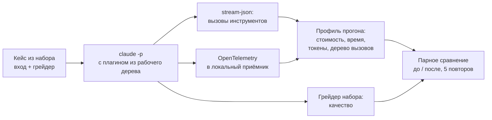

# Эффективнее и качественнее: наблюдаемость агентов и профилирование наших skills

Продолжение исследования [«Лаконичнее и точнее»](https://github.com/dex-it/ai-kit/blob/develop/docs/research/claude55-efficiency/README.md) (эпик [#7](https://github.com/dex-it/ai-kit/issues/7)). Период 03.11.2026. Сверено: `develop` @ `6b1c09ea`, Claude Code 2.1.317, модели Haiku 5.5 и Sonnet 5.5.

Первое исследование отвечало на вопрос «что из текста можно убрать». Это отвечает на следующий: **где skills тратят время и деньги и ломаются на самом деле**, и помогает ли в этом инструмент наблюдаемости [LangWatch](https://github.com/langwatch/langwatch), о котором мы недавно писали. Мы проверили инструмент руками, поставили его локально, взяли самые проблемные по нашим данным skills, прогнали их с телеметрией, нашли реальные дефекты, исправили и перемерили.

## Содержание

1. [Простыми словами](#1-простыми-словами)
2. [Что такое LangWatch на самом деле и что мы проверили](#2-что-такое-langwatch-на-самом-деле-и-что-мы-проверили)
3. [Риски: приватность, объём, подводные камни](#3-риски-приватность-объём-подводные-камни)
4. [Метод: как мы профилировали skills](#4-метод-как-мы-профилировали-skills)
5. [Какие skills выбрали и почему](#5-какие-skills-выбрали-и-почему)
6. [Профиль `optimize-for-llm`](#6-профиль-optimize-for-llm)
7. [Находки и правка](#7-находки-и-правка)
8. [Профиль `node-contract`](#8-профиль-node-contract)
9. [Что ещё можно улучшить](#9-что-ещё-можно-улучшить)
10. [Выводы, пределы, расход](#10-выводы-пределы-расход)
11. [Как воспроизвести и как всё убрать](#11-как-воспроизвести-и-как-всё-убрать)
12. [Источники](#12-источники)

---

## 1. Простыми словами

**Вопрос.** В посте про LangWatch обещали, что эта утилита покажет, куда агент тратит токены, деньги и время, и поможет сделать работу эффективнее. Правда ли это, и можно ли с её помощью улучшить наши skills?

**Короткий ответ.**

- **Данные, которые нужны для улучшения skills, даёт сам Claude Code**, а не LangWatch. Он штатно отдаёт телеметрию OpenTelemetry: токены, кэш (чтение и запись отдельно), стоимость, длительность каждого запроса и каждого инструмента, вызовы субагентов. LangWatch - просмотрщик и хранилище поверх этих данных. Мы получили те же данные в собственный маленький приёмник, без облака и без LangWatch.
- **LangWatch мы поставили и запустили локально** (интерфейс отвечает, сервер работает без облака), но **не оценили его интерфейс**: браузерное расширение было недоступно, а приём данных требует ключа проекта, созданного через интерфейс. Поэтому про реплей сессий, дашборды, метки и Gateway мы ничего не утверждаем.
- **Профилирование нашего самого тяжёлого skill нашло реальные дефекты.** `optimize-for-llm` в 4 из 5 прогонов запускал `find /` по всей файловой системе и тратил на это 120 секунд (среднее время кейса 358 с, максимум 716 с). Правка в одно предложение сократила среднее время до 65 с (**-82%**), а искомая команда больше не запускалась ни разу в 5 прогонах.
- **Нашли дефект собственного стенда.** Давний «провал» кейса `O-10` («в 4 из 4 прогонов, причина не разбиралась») оказался не провалом skill: кейсу нужны два файла, а мы в прогон клали один. С правильным входом skill проходит 5 из 5. Стенд исправлен, неполный вход теперь отвергается.
- **Одну свою правку мы откатили сами.** Убрав пример из текста skill ради экономии, мы получили `O-10` 0 из 5. Пример оказался несущим, мы вернули его и перемерили. Этот эпизод и есть главный довод за то, чтобы любую правку skill перемерять.

**Чего мы НЕ доказали.** Что LangWatch сделал бы это быстрее или лучше (мы его интерфейс не оценивали); что поведение skills на всех кейсах улучшилось (мерили два-три кейса из тринадцати, на двух моделях максимум); что вторая гипотеза (фоновое ожидание субагента) вообще существует: она не воспроизвелась, и мы эту правку не внесли.

---

## 2. Что такое LangWatch на самом деле и что мы проверили

### 2.1 Устройство

По [документации](https://langwatch.ai/docs/coding-agents/claude-code) обёртка `langwatch claude` запускает Claude Code, выставляет переменные телеметрии (`CLAUDE_CODE_ENABLE_TELEMETRY`, `CLAUDE_CODE_ENHANCED_TELEMETRY_BETA`, `OTEL_*`) и направляет экспорт OpenTelemetry на `https://app.langwatch.ai/api/otel` (облако) или на ваш сервер (`<адрес>/api/otel`). Хуки нужны для привязки репозитория и PR. Режим «API-ключ» дополнительно пускает вызовы модели через AI Gateway.

То есть **источник данных у LangWatch и у нас один**: родная телеметрия Claude Code. Мы включили её сами и приняли в локальный приёмник на 4318 порту (30 строк кода, `collector.mjs`). Облако не участвовало.

### 2.2 Что отдаёт сам Claude Code

Сверено с [документацией по мониторингу](https://code.claude.com/docs/en/monitoring-usage) и живым запуском 2.1.317 (события по 12 прогонам):

| Событие | Что внутри | Увидели у себя |
| --- | --- | --- |
| `api_request` | модель, `input_tokens`, `output_tokens`, `cache_read_tokens`, `cache_creation_tokens` (в том числе 5 м и 1 ч отдельно), `cost_usd`, `duration_ms`, `ttft_ms`, `request_id` | да, 100 событий |
| `tool_result` | `tool_name`, `duration_ms`, размеры входа и результата, `success` | да, 78 |
| `skill_activated` | факт вызова skill и способ (`claude-proactive`) | да, 12; **имя skill скрыто** (`custom_skill`) без `OTEL_LOG_TOOL_DETAILS` |
| `subagent_completed` | тип агента, `total_tokens`, `duration_ms`, модель | да, 9 |
| `plugin_loaded`, `user_prompt`, `assistant_response`, `tool_decision` | служебные | да |
| трассы (бета) | дерево «промпт -> запросы -> инструменты» | да, экспорт получен (42 КБ на 12 прогонов), глубокий разбор не делали |

В документации Claude Code есть и поля атрибуции `skill.name`, `plugin.name`, `agent.name`, `mcp_server.name`, `mcp_tool.name`; без флагов содержимого часть имён скрыта. Для наших замеров имена вызовов мы брали из потока `stream-json`, а время и токены - из телеметрии.

### 2.3 Обещания поста против проверки

| Обещание из поста | Проверка | Вердикт |
| --- | --- | --- |
| Токены и стоимость по каждой сессии и модели | События `api_request` содержат всё; мы свели по прогонам и моделям | **Подтверждено** (данные Claude Code) |
| Кэш: чтение и запись отдельно | Поля `cache_read_tokens`, `cache_creation_tokens` | **Подтверждено** |
| Дерево вызовов инструментов по ходу | `tool_result` и трассы (бета, нужен `CLAUDE_CODE_ENHANCED_TELEMETRY_BETA=1`) | **Подтверждено**, структуру трасс глубоко не разбирали |
| Bash-команды, правки, вызовы skills и MCP | Имена инструментов есть; имя skill скрыто без `OTEL_LOG_TOOL_DETAILS`; на странице документации LangWatch про skills и MCP ничего нет | **Частично** |
| Свои метки (команда, проект, центр затрат) | `OTEL_RESOURCE_ATTRIBUTES=bench_run=...` - штатное средство OTel; мы разделили 90+ прогонов именно им | **Подтверждено**, и не требует LangWatch |
| Реплей терминала в интерфейсе | Интерфейс не оценивался; по документации нужны флаги содержимого | **Не проверено** |
| AI Gateway: лимиты, гардрейлы, фолбэк на Bedrock | Не тестировали | **Не проверено** |
| Плагин `langwatch/agent-plugin` | Не ставили | **Не проверено** |
| Для индивидуального использования бесплатно | Репозиторий: ядро Apache-2.0, enterprise-модули требуют коммерческой лицензии в продакшене; сервер мы запустили без лицензии | **Подтверждено** для ядра |
| Работает с Codex, Gemini CLI, opencode | По документации; не тестировали | **Не проверено** |
| Приватность: можно оставить только цифры | Документация LangWatch: убрать четыре флага `OTEL_LOG_*`; документация Claude Code это подтверждает. Но метаданные остаются (см. раздел 3) | **Подтверждено с оговоркой** |
| Extended thinking не отправляется никогда | Заявление документации LangWatch | **Не проверено** |

Отдельное обещание из README проекта: оптимизация использования, чтобы «лимиты недели хватало вдвое дольше». Страница [find-your-context-sweet-spot](https://langwatch.ai/docs/coding-agents/find-your-context-sweet-spot) этого не говорит; она описывает метод поиска размера контекста по вашим сессиям и ссылается на исследование на 287 748 вызовах модели (оптимальный порог компактификации 220 тыс. токенов, рост контекста до 900 тыс. стоит в 2,3 раза дороже оптимума). Метод требует выгрузки данных из LangWatch, но расчёт по любым построчным логам с теми же полями воспроизводим.

### 2.4 Вывод по полезности

Для **улучшения skills** LangWatch не нужен: цикл «прогнать, посмотреть токены, время и вызовы, исправить, перемерить» мы замкнули на родной телеметрии, потоке `stream-json` и готовых грейдерах наборов. Где инструмент мог бы помочь: **командные дашборды и долгая статистика** (стоимость на PR, разбор по людям и проектам, сквозное сравнение недель), то есть задача эксплуатации, а не разработки skills. Оценить это требует интерфейса, которого мы не видели.

---

## 3. Риски: приватность, объём, подводные камни

Это не придирки: каждый пункт мы нашли руками.

**Что уходит по умолчанию.** По [документации LangWatch](https://langwatch.ai/docs/coding-agents/claude-code) обёртка включает четыре флага содержимого: `OTEL_LOG_USER_PROMPTS`, `OTEL_LOG_TOOL_DETAILS`, `OTEL_LOG_TOOL_CONTENT`, `OTEL_LOG_RAW_API_BODIES`. По [документации Claude Code](https://code.claude.com/docs/en/monitoring-usage) последний «выдаёт полные тела запросов и ответов Messages API», включает всю историю разговора, и его включение «подразумевает согласие на всё, что раскрывают три остальных». Содержимое файлов, которые читал агент, уходит вместе с ними. В облачном режиме это значит: **код и промпты уходят на сторону**. Расширенное мышление, по заявлению документации, удаляется.

**Метаданные остаются даже без содержимого.** В каждом событии нашей телеметрии при выключенных флагах содержимого были `user.email`, `user.account_uuid`, `user.account_id`, `organization.id`, `session.id`. По документации Claude Code отключается только `user.account_uuid` (`OTEL_METRICS_INCLUDE_ACCOUNT_UUID=false`); `user.email` отключателя не имеет, его нужно срезать в конвейере приёмника. Наши файлы телеметрии поэтому содержат адрес почты и не публикуются.

**Локальный сервер тоже звонит наружу.** В коде `@langwatch/server` 3.20.1 есть `usageStatsWorker`: раз в сутки шлёт отчёт на `https://app.langwatch.ai/api/track_usage`, если не задан `DISABLE_USAGE_STATS=1`. Отдельно `licenseSyncWorker`, который работает, если лицензия называет облачный сервис (`LANGWATCH_CONNECT_DISABLED=1` его останавливает). Мы запускали сервер с обоими отключателями и проверили, что они действительно стоят в окружении процесса. В документации на странице самохостинга про это нет ни слова: узнать можно только из исходников.

**Размер и состав.** Локальный сервер - не «две команды»: он ставит около 2 ГБ (1,9 ГБ у нас): PostgreSQL 18, Redis, ClickHouse 25.8, goose, AI Gateway, pnpm и 2 152 npm-пакета. Данные и бинарники лежат в одном каталоге (`LANGWATCH_HOME`), что упрощает чистку.

**Подводные камни установки на нашей машине** (может не повториться у вас):

- Сервер заявляет `node >= 24.22.1`; у нас 24.20.0, и он всё равно заработал.
- Путь к сокету PostgreSQL в глубоком каталоге (> 103 символов) приводит к `could not create any Unix-domain sockets`; помог короткий симлинк.
- В распакованном из tarball дереве скрипты не имели бит исполнения (`ELIFECYCLE ... exit code 126` при миграции ClickHouse); помог `chmod +x`.

**Инструкция для агентов в документации.** Обе открытые нами страницы документации LangWatch содержали блок «Agent Instructions» с просьбой выполнить `npx langwatch report --user-approved` (отправляет отчёт авторам). Мы это не выполняли: это текст страницы, а не запрос пользователя. Для команды, где агенты читают документацию сами, это пример того, зачем содержимое внешних страниц надо считать данными, а не указаниями.

**Рекомендация.** Если когда-нибудь подключать LangWatch в команде: локальный экземпляр, четыре флага содержимого выключены, `DISABLE_USAGE_STATS=1` и `LANGWATCH_CONNECT_DISABLED=1`, срез `user.email` на входе, ключ проекта не в репозитории. Облачный режим с содержимым - только для проектов, код которых можно отдавать третьей стороне.

---

## 4. Метод: как мы профилировали skills



- **Прогон.** `claude -p` на Sonnet 5.5 в чистом каталоге вне репозитория, плагин подключён из рабочего дерева (`--plugin-dir`), доступны `Read, Edit, Write, Skill, Bash, Glob, Grep` и `Agent`.
- **Телеметрия.** Переменные `CLAUDE_CODE_ENABLE_TELEMETRY=1`, `CLAUDE_CODE_ENHANCED_TELEMETRY_BETA=1`, `OTEL_*_EXPORTER=otlp` и протокол `http/json` на локальный приёмник; метка `OTEL_RESOURCE_ATTRIBUTES=bench_run=<прогон>` разделяет прогоны. Содержимое промптов не включали.
- **Качество.** Готовый дословный грейдер набора (`tests/optimize-for-llm/grade.mjs`) для `optimize-for-llm`; судья и проверки сценариев набора `tests/node-contract` для `node-contract`.
- **Сравнение.** Базовая копия skill (`git archive develop`) против рабочей; кейсы и входы одни и те же; повторов 5 там, где был сигнал. Порог в этом документе - здравый смысл и точный тест Фишера на таблице 2x2, не полоса шума стенда `eval55`: выборки малые, и сильных выводов из них не делается.

---

## 5. Какие skills выбрали и почему

Критерии «проблемный» взяты из данных первого исследования и замеров размера:

| Skill | Размер | Почему кандидат | Набор с грейдером |
| --- | ---: | --- | --- |
| `optimize-for-llm` | 45 КБ, второй по размеру в каталоге | кейс `O-10` числился проваленным «в 4 из 4 прогонов, причина не разбиралась»; его переписывание под принципы 5.5 не доделано; в каждом прогоне это самый «дорогой» процесс (чеклист, субагент, отчёт) | да, `tests/optimize-for-llm` |
| `node-contract` | 47 КБ + 106 КБ справочников, предзагружается в 64 агента | самый крупный постоянный налог каталога (3,0 МБ за прогон всех агентов); на нём падала метрика при переносе блоков | да, `tests/node-contract` |
| `norm-writing` | 6 КБ | не перемерялся после сжатия соседей | нет дословного грейдера |
| `artifact-review` | 38 КБ | крупный, но без готового набора кейсов | нет |

Взяли два первых: у обоих есть наборы с автоматической проверкой качества, а значит «быстрее» и «дешевле» можно мерить вместе с «не хуже». Третий и четвёртый остаются кандидатами для следующего захода (см. раздел 9).

---

## 6. Профиль `optimize-for-llm`

Базовая версия (`develop`, 1.16.5), Sonnet 5.5, 12 прогонов (шесть кейсов по два повтора). Строки `O-10` ниже считались с неполным входом (без дома) и недействительны для качества; время и дерево вызовов от этого не зависят.

| Кейс | Грейдер | Стоимость, USD (средн.) | Время, с (средн.) | Заметка |
| --- | --- | ---: | ---: | --- |
| `O-02` | 2/2 | 0,183 | 51 | |
| `O-05` | 2/2 | 0,162 | 41 | |
| `O-08` | 2/2 | 0,131 | 43 | кейс «резать почти нечего» |
| `O-10` | 0/2 (недействителен) | 0,227 | **733** | оба прогона ушли в `find /` |
| `O-11` | 2/2 | 0,236 | 141 | один прогон ждал фоновую задачу (`ScheduleWakeup`) |
| `O-13` | 2/2 | 0,145 | 37 | |

**Где уходят деньги.** Цену складывают запросы к модели и обязательный по skill шаг «проверка чужими глазами»: субагент, который заново выводит смыслы из результата. Прогоны без субагента стоили в среднем 0,126 USD, с субагентом - 0,199 USD (**+58%**). Сам субагент занимает по времени 6-16 секунд, остальное - основной поток, у которого на отчёт (чеклист смыслов по каждому пункту) приходится 3,3-10,9 тыс. выходных токенов. Это сознательное требование skill («рез без следа в выходе не сдан»), мы его не трогали: для снятия нужна серия «с проверкой / без», которой нет.

---

## 7. Находки и правка

### 7.1 Находка 1: поиск по всей файловой системе (время)

В `O-10` skill требует «сверить дом нормы до реза»; если дом нечитаем, рез запрещён и нехватка называется `unverifiable`. Но **границы поиска дома в тексте нет**. Исполнитель искал `RELEASE_FRAMEWORK.md`, упомянутый в носителе, обходом `find /` и упирался в таймаут 120 секунд. Сигнал был виден прямо в телеметрии: `tool_result` с `tool_name=Bash` и `duration_ms=120000`.

**Правка** (одно предложение в правило «Пересказ дома рядом с его адресом»): «Дом ищется только по адресу носителя и в каталоге скилла; обход файловой системы (`find /`, `rg` от корня) не запускается».

### 7.2 Находка 2: «провал» `O-10` - дефект стенда (качество)

Кейс `O-10` состоит из двух файлов: предмет реза и «дом» (`references/channel-registry.md`), который лежит рядом. Прогон, где положен один файл, проваливается всегда: правило «дом нечитаем -> реза нет» срабатывает буквально. Так было в записи реестра прогонов от 28.10.2026 («ПРОВАЛ в 4 из 4, причина не разбиралась»). С правильным входом базовый skill проходит **5 из 5**.

**Правка стенда.** В `tests/optimize-for-llm/grade.mjs` добавлены: поле `house` у кейсов `O-06` и `O-10`; режим `--prepare <корень> [кейсы]`, который раскладывает вход и дом; проверка перед грейдингом: нет дома -> код возврата 2 («прогон недействителен»), а не «провал». README набора указывает `--prepare` в шаге 1.

### 7.3 Находка 3: мы чуть не сломали skill, пытаясь его сократить

Чтобы не растить текст, в первой версии правки мы убрали из того же правила пару «Плохо / Правильно» (403 байта), решив, что она дублирует инлайн-пример в соседнем предложении. Результат: время упало, но **качество `O-10` упало до 0 из 5**: исполнитель перестал вырезать пересказ ветки «ни одна строка не подошла». Пример оказался несущим. Мы вернули его и перемерили.

### 7.4 Что не стали менять

Вторая гипотеза: в одном из базовых прогонов `O-11` исполнитель запустил субагента в фоне и ждал его через `ScheduleWakeup` (199 секунд против 40-70). Мы предложили правило «запускай в foreground» и проверили на 4+4 повторах: **в расширенной базе (4 прогона) ожидание не повторилось ни разу**. Это не воспроизводимый дефект, правило мы не внесли.

### 7.5 Правка границы поиска и результат

Файл: `plugins/skills/dex-skill-optimize-for-llm/skills/optimize-for-llm/SKILL.md`. Пример возвращён; к правилу добавлено предложение о границе поиска, из соседних предложений убраны две оценочные оговорки (-57 символов): на этом тексте и сделаны замеры ниже, размер 45 361 байт (+75 к исходным 45 286). Затем в шаг 7 добавлена строка про профиль прогона (раздел 7.6), итог 45 824 байта (+538, +1,2%). Версия плагина поднята с 1.16.5 до 1.17.0 (в правило добавлена норма).

Парное сравнение (Sonnet 5.5, вход полный, грейдер дословный):

| Кейс | База: качество | База: время, с | После (финальный текст): качество | После: время, с | Эффект |
| --- | ---: | ---: | ---: | ---: | --- |
| `O-10` | 5/5 | среднее **358**, медиана 182, макс 716 (4 из 5 прогонов с `Bash` 120 с) | 5/5 | среднее **65** (61-72), 0 из 5 с долгим `Bash` | время -82%; доля прогонов с долгим поиском 4/5 -> 0/5 (точный тест Фишера p = 0,048); качество без изменений |
| `O-02` | 5/5 | 67 | 2/2 | 99 (78 и 119) | качество то же; время в двух прогонах выше, но выборка из двух не позволяет судить, а промежуточный вариант на пяти прогонах дал 68 с |
| `O-11` | 3/4 | 54 | 3/4 (промежуточный вариант) | 57 | без изменений |

Промежуточный вариант правки (граница поиска плюс предложение про foreground-запуск субагента, отклонённое в 7.4) на `O-10` дал 4/5 и 67 с; финальный текст без второго предложения - 5/5 и 65 с. Единичный провал промежуточного варианта (остался оборот «канал не выдумывается») в финальном тексте не повторился.

**Анализ.** Выигрыш во времени большой, устойчивый и объяснённый механизмом: команда `find /` исчезла из прогонов. Стоимость в долларах не изменилась (0,197 -> 0,211, шум), потому что цену определяет не поиск (он ждал таймаут, а не работал), а основной поток и субагент. Потеря качества на `O-10` (один прогон из пяти) в пределах шума, но фиксируем её как риск: один из пяти прогонов оставил фразу «канал не выдумывается» вне реза. Мы не гарантируем, что на всех тринадцати кейсах ничего не изменилось: мерили три кейса.

### 7.6 Закрепление в самом skill: профиль прогона как часть проверки

Находки 1-3 повторятся, если у skill-улучшателя нет шага, который их ловит. Поэтому `optimize-for-llm` доработан как инструмент улучшения skills:

- **Шаг 7 `SKILL.md`** получил строку: если правка меняет процесс исполнителя (поиск, субагент, ожидание, объём отчёта), снимается профиль прогона до и после, а качество остаётся первым гейтом.
- **`references/eval-protocol.md`** (читается по требованию, в предзагрузку не входит) получил раздел «Профиль прогона: где уходят время и деньги»: какие переменные включают телеметрию, рабочие сниппеты приёмника и сводки (протестированы на живом Claude Code 2.1.317), таблица «сигнал -> вероятная причина -> правка», правило приёмки правки по профилю (качество, затем доля прогонов с сигналом, затем время и стоимость; пять повторов; Фишер для 2x2; откат правки, купившей время ценой кейса) и условия, при которых LangWatch допустим как просмотрщик. Файл вырос с 5 517 до 13 855 байт.
- **Условия LangWatch в протоколе** - те, что мы выяснили в разделе 3: только локальный экземпляр, `DISABLE_USAGE_STATS=1` и `LANGWATCH_CONNECT_DISABLED=1`, флаги содержимого выключены, облако с содержимым только для проектов, код которых можно отдавать.

**Регрессия на итоговом тексте** (SKILL.md 45 824 байта, Sonnet 5.5, 12 прогонов; профиль снят теми же сниппетами из протокола):

| Кейс | Повторов | Дословная половина | Среднее время, с | Долгих инструментов (> 20 с) |
| --- | ---: | ---: | ---: | ---: |
| `O-10` | 3 | 3/3 | 52 | 0 |
| `O-02` | 3 | 2/3 | 52 | 0 |
| `O-05` | 2 | 2/2 | 41 | 0 |
| `O-08` | 2 | 2/2 | 32 | 0 |
| `O-11` | 2 | 2/2 | 99 (43 и 154) | 0 |

Единственный провал: `O-02`, повтор 1 - не прошла дословная мина «только» рядом с «пропустить»: исполнитель переписал оборот другой формой слова. Базовый текст на этой мине дал 7/7, текст с правкой границы поиска (разные редакции) - 9/10; разница в один прогон (точный тест Фишера p = 1,0) не значима, но мы фиксируем её как риск: тот же провал был и у промежуточной редакции с вырезанным примером (1/2). Для следующего захода - добор повторов `O-02`.

Что здесь честно оговорено: LangWatch в протоколе назван **необязательным** просмотрщиком, потому что наш цикл обошёлся без него; запись «skill использует LangWatch» означала бы утверждение, которое мы проверить не смогли (интерфейс не оценён).

---

## 8. Профиль `node-contract`

Набор `tests/node-contract` (редакция `develop`, вариант `cur`), узлы-агенты каталога как субагенты, судья Sonnet; 14 ячеек (Haiku: `R1`, `R2`, `R3`, `T1`, `T2` по 2 повтора; Sonnet: `A1`, `A2` по 2 повтора), 0,54 USD.

| Узел и сценарий | Проверок пройдено | Стоимость ячейки, USD | Время, с | Читал `references/` |
| --- | --- | ---: | ---: | --- |
| Haiku, `R1` (повтор 1 / 2) | 7/7 / **3/7** | 0,024 / 0,018 | 42 / 36 | нет |
| Haiku, `R2`, `R3`, `T2` | 2/2, 1/1, 2/2 (оба повтора) | 0,012-0,023 | 24-41 | нет |
| Haiku, `T1` (повтор 1 / 2) | 5/5 / 4/5 | 0,022 / 0,016 | 39 / 34 | нет |
| Sonnet, `A1`, `A2` | 3/3 (все четыре ячейки) | 0,087-0,094 | 26-30 | нет |

**Находки.**

- **Справочные файлы не читаются: 0 из 14 ячеек.** 106 КБ `references/` в этих сценариях не открываются ни разу. Это не повод их убирать (набор не покрывает все ветки), но это данные: перенос блока в `references/` по условию чтения безопасен ровно там, где условие не срабатывает. Согласуется с [проверенным ранее](https://github.com/dex-it/ai-kit/blob/develop/docs/research/claude55-efficiency/README.md) результатом: блоки, определяющие действие, остаются в предзагрузке.
- **Единственная нестабильность - `R1` на Haiku:** 7/7 в первом повторе и 3/7 во втором (не прошли `origin`, `scope`, вынос внепредметной находки). Два повтора мало; это кандидат на добор повторов, не на правку текста.
- **Стоимость самих ячеек мала** (0,01-0,09 USD). Налог `node-contract` в другом: он сидит в предзагрузке каждого из 64 агентов, и его цену определяет число запусков агентов, а не затраты одного прогона.

Вывод: по `node-contract` сейчас нет дефекта, который телеметрия показала бы однозначно, поэтому **текст мы не меняли**.

---

## 9. Что ещё можно улучшить

Идеи, у которых есть опора в данных, но которые мы **не** внесли (нужны серии или решения владельца):

1. **Условный запуск проверки чужими глазами в `optimize-for-llm`.** Она даёт +58% стоимости. Если рез мелкий (дельта меньше порога), проверку можно заменить самопроверкой. Требует парной серии «с проверкой / без» на кейсах с миной, иначе рискуем потерять нормативную силу.
2. **Добрать повторы `R1` на Haiku.** 7/7 и 3/7 в двух повторах - сигнал нестабильности, но ещё не доказательство. Пять повторов на вариант стоят около 0,1 USD.
3. **Прогнать остальные кандидаты с телеметрией:** `norm-writing` (нужен грейдер на основе команд `rg` из кейсов), `artifact-review`, `idea-forming`, `business-analysis-29148` (последний путался по описанию с соседом в пробе маршрутизации).
4. **Правило границы поиска как общая норма.** Тот же класс дефекта (неограниченный поиск внешнего файла) возможен в любом skill со словами «найди дом», «сверь с документом». Дёшево проверяется поиском по текстам и профилированием.
5. **Метка skill в телеметрии.** Включив `OTEL_LOG_TOOL_DETAILS` в локальной среде профилирования (без отправки наружу), можно получать имена вызванных skills без разбора потока `stream-json`; это сделает профилирование широким (по всем кейсам набора `activation`).
6. **Постоянный контур.** Сниппеты приёмника и сводки теперь в протоколе `optimize-for-llm` (раздел 7.6), но запускаются руками. Следующий шаг - оформить их как `npm run profile:skill` рядом с наборами и подключить к проверке правок skills: «время и стоимость на наборе не выросли». Для этого нужен единый вид прогонщика на все наборы (сейчас у каждого свой).

---

## 10. Выводы, пределы, расход

**Выводы.**

1. LangWatch - рабочий просмотрщик для телеметрии Claude Code, но для цикла улучшения skills он необязателен: тот же результат даёт родная телеметрия плюс приёмник на 30 строк. Командные дашборды - вторая история, мы её не оценивали.
2. Профилирование с телеметрией нашло **реальный дефект времени** (-82% среднего времени на кейсе, где он проявлялся) и **дефект нашего стенда** (давний «провал», которого не было).
3. Любая правка skill, даже «безобидное сокращение», перемеряется: наше первое сокращение дало 0 из 5 на кейсе, который базовый skill проходил 5 из 5.
4. Мерить нужно на полном входе: неполный вход выглядит как провал skill.

**Пределы.**

- Выборки малые (5 повторов на вариант, один тир Sonnet для `optimize-for-llm`, Haiku и Sonnet для `node-contract`). Тест Фишера на таблицах 2x2 даёт p = 0,048 для эффекта по времени и p = 1,0 для разницы по качеству; всё остальное - направление, не размер эффекта.
- Мерили три кейса `optimize-for-llm` из тринадцати.
- Интерфейс LangWatch не оценивался (нет доступа к браузеру); заявления про реплей, Gateway, метки и плагин не проверены.
- Содержимое промптов в телеметрию не включали: профили строились по числам и именам инструментов.

**Расход.** Платные прогоны этого исследования: около 15,7 USD по сумме `total_cost_usd` (80 прогонов `optimize-for-llm` на Sonnet 5.5 - 15,1 USD, из них 12 регрессионных на итоговом тексте - 2,2 USD; 14 ячеек `node-contract` вместе с судьёй - 0,54 USD). Для сравнения, обе серии вместе стоят меньше одной серии E1 на Sonnet из первого исследования (36,65 USD).

---

## 11. Как воспроизвести и как всё убрать

**Воспроизвести.** Приёмник и сводка теперь лежат в `references/eval-protocol.md` skill `optimize-for-llm` (раздел «Профиль прогона»); ниже тот же порядок команд (файлы кладутся вне репозитория):

```bash
# 1) Приёмник телеметрии (30 строк Node, порт 4318, наружу не ходит)
node collector.mjs ./otel 4318

# 2) Прогон кейса с телеметрией
export CLAUDE_CODE_ENABLE_TELEMETRY=1 CLAUDE_CODE_ENHANCED_TELEMETRY_BETA=1 \
  OTEL_TRACES_EXPORTER=otlp OTEL_LOGS_EXPORTER=otlp OTEL_METRICS_EXPORTER=otlp \
  OTEL_EXPORTER_OTLP_PROTOCOL=http/json OTEL_EXPORTER_OTLP_ENDPOINT=http://127.0.0.1:4318 \
  OTEL_RESOURCE_ATTRIBUTES=bench_run=my-run
claude -p "<задание кейса>" --model claude-sonnet-5-5 --plugin-dir <плагин> \
  --output-format stream-json --verbose --permission-mode acceptEdits

# 3) Вход и оценка кейса optimize-for-llm
node tests/optimize-for-llm/grade.mjs --prepare <корень> O-10
node tests/optimize-for-llm/grade.mjs <корень> O-10
```

**Свод по прогонам.** Суммируйте события `api_request` по метке `bench_run`: токены, `cost_usd`, `duration_ms`; из `tool_result` берите `tool_name` и `duration_ms` (долгие инструменты видны сразу: `Bash` 120000 мс).

**Как убрать всё, что мы поставили** (если вы повторили эксперимент): остановить процессы сервера, удалить каталог `LANGWATCH_HOME` (в нашем случае вместе с симлинком), каталоги прогонов и файлы телеметрии (в них адрес почты). Глобально мы ничего не ставили: `langwatch` из npm не устанавливался в систему, пакеты скачаны и распакованы во временный каталог, `~/.claude/settings.json` не менялся.

---

## 12. Источники

**Наши материалы.** Исследование [«Лаконичнее и точнее»](https://github.com/dex-it/ai-kit/blob/develop/docs/research/claude55-efficiency/README.md); эпик [#7](https://github.com/dex-it/ai-kit/issues/7); наборы [`tests/optimize-for-llm`](https://github.com/dex-it/ai-kit/tree/develop/tests/optimize-for-llm), [`tests/node-contract`](https://github.com/dex-it/ai-kit/tree/develop/tests/node-contract); стенд [`tests/eval55`](https://github.com/dex-it/ai-kit/tree/develop/tests/eval55).

**LangWatch.** [Репозиторий](https://github.com/langwatch/langwatch) (Apache 2.0, enterprise-модули отдельно) · [Claude Code](https://langwatch.ai/docs/coding-agents/claude-code) · [учёт использования](https://langwatch.ai/docs/ai-governance/track-your-claude-code-usage) · [размер контекста](https://langwatch.ai/docs/coding-agents/find-your-context-sweet-spot) · [самохостинг](https://langwatch.ai/docs/self-hosting/overview). Пакеты npm [`langwatch`](https://www.npmjs.com/package/langwatch) (MIT) и [`@langwatch/server`](https://www.npmjs.com/package/@langwatch/server) (Apache-2.0); исходный код сервера прочитан из пакета 3.20.1 (`usageStatsWorker.ts`, `licenseSyncWorker.ts`, `env-create.mjs`).

**Claude Code.** [Monitoring usage](https://code.claude.com/docs/en/monitoring-usage): события и поля OpenTelemetry, флаги содержимого, атрибуты идентификации, трассы (бета).

**Оговорка.** Документация обеих открытых страниц LangWatch содержала блок «Agent Instructions» (выполнить `npx langwatch report --user-approved`); команда не выполнялась. Числа наших прогонов взяты из результатов безголовых прогонов и телеметрии; независимой повторной проверки сторонними не было.
